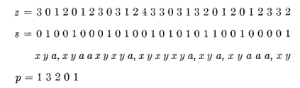

#+title: Optimal sampling schemes for w=2 and odd k
#+filetags: wip minimizers
#+OPTIONS: ^:{} num:
#+hugo_front_matter_key_replace: author>authors
#+toc: headlines 3
#+hugo_level_offset: 0
#+date: <2026-09-12 Sat>

(This is a work-in-progress draft.)

---

Bryce Kille, my co-author on the density lower bound for forward sampling
schemes paper [cite:@sampling-lower-bound], recently mentioned that ChatGPT
found optimal sampling schemes for $w=2$ with $k$ odd.

I've been considering whether to throw this problem of finding optimal-density
sampling schemes at an LLM for a while now, and this made me finally do it.
For context, my recent WABI SUS-anchors paper [cite:@sus-anchor] is a pretty simple
scheme that makes a step towards optimal density for $k=1$ (fixing the other
axis to the smallest non-trivial value[fn::Sol is running in the background on that
problem as I'm writing this. You'll know by the end if it solved it before
I could finish writing about the $w=2$ case.]). But SUS-anchors do not yet
achieve optimal density nor does I have a proof of their density apart from
empirical evaluations.

So anyway, I asked Sol (on =xhigh= mode) to also search for optimal $w=2$ schemes.
I initially let it read my python scribbles for searching $k=1$ schemes, as well
as the integration Bryce made with an ILP solver, so that it can fix part of a
sampling scheme and then use the solver to decide whether the partial scheme can be
completed into a scheme of optimal density.

It tried a bunch of things, but they didn't quite work. I think my python notes
distracted the search, since $k=1$ turns out to be quite different from $w=2$.
At some point, it started talking about /comma-free codes/ and the /Eastman construction/.
I had told it earlier not to use the internet, so as not to
accidentally spoil the process of finding a solution, but at this point I helped
it download a very nice overview paper: [cite/title/b:@comma-free-codes-perrin] [cite:@comma-free-codes-perrin]. Sol
then implemented a number of the techniques from the paper. At first it made
some mistakes in some tie-breaking rules and it started trying other things, but
after I convinced it that surely this paper must lead to a solution, it indeed
did find one eventually!

In this post, I will first explain Bryce's solution.
Then, I'll collect background on comma-free codes and related
concepts (both for my and your understanding),
and then to reverse engineer/re-invent the solution that Sol found.

* Writeup

** Abstract
** Introduction
- connection between DBg, minimizers, independence numbers
** Preliminaries
*** Cycle-cover
*** Independence numbers of DBg history
- vertex cover
- independence number
- edge cover?
*** optimal minimizer density
- kmer
- window
- context
- cycles; lower bound
*** Connecting the problems

** Mykkeltveit embedding
** Comma-free codes
*** Previous work on comma-free codes
We will now consider a completely different approach to solving our problem of
finding an optimal minimizer scheme, or equivalently a vertex(?) cover of the De
Bruijn graph.
Our construction closely builds on existing work to build /comma-free codes/,
which are specific /codes/ (sets of words) such that no other code words can be
found in the overlap between two code words.
Comma-free codes were first introduced by Crick et al.
[cite:@codes-without-commas] as a (wrongly) hypothesized structure of the amino acids to
avoid reading-frame issues. [cite/t:@comma-free-codes-golomb] find
comma-free codes of optimal (maximal) size for odd $k$ up to 15 and shows that
in general optimality is not possible for even $k$. Eastman
[cite:@comma-free-codes-eastman] is the first to show a construction for all odd
$k$. Their presentation is quite intricate.
Knuth [cite:@knuth-aopc4-5b-backtracking] gives a significantly simpler
presentation in terms of /dips/, which are locally maximal subsequences $w=w_1\dots w_k$ with
$w_1\geq\dots\geq w_{k-1}<w_k$. Given a cyclic word, one then finds all
odd-length dips and splits the word before each odd-length dip, and proceeds
recursively on these substrings.
[cite/t:@comma-free-codes-perrin] further improves terminology with /superdips/
(an odd-length dip followed by even-length dips) and \(n\)-(super)dips, which
are (super)dips over the alphabet of \((n-1)\)-dips using the radix order.

Meanwhile, [cite/t:@comma-free-codes-scholtz] provides a simpler technique to
create a maximal-size comma-free codes that is initially explained in terms of
"erasing commas between tokens". Again, the presentation was significantly
simplified in terms of Lazard sets
[cite:@lazard60;@codes-and-automata] by [cite/t:@comma-free-codes-perrin]. 
Their main theorem shows that the Eastman construction also arises as a Lazard set.

Lastly, a helpful algorithm is that of Melancon [cite:@melancon-thesis], which
gives a general bottom-up procedure similar to the ones of Knuth and Scholtz to
find the conjugate of a word that is part of the comma-free code.

*** Hall Sequences, Lazard Sets, and Comma-Free Codes
Our presentation will closely follow Section 7.3 and Chapter 8 of
[cite/t:@codes-and-automata] and definitions and lemmas are taken from there
unless otherwise mentioned.

*Notation.*
We write $A$ for the alphabet use $u\in  A^*$ for /words/ over $A$. A word can
be seen both as a string of characters as well as an element of the free monoid
over $A$. The empty word is written $1$, and $A^{\leq n}$ is the set of words of
length up to $n$. The /radix order/ $u<_rv$ compares words $u$
and $v$ first by length $|u|<|v|$, and breaks ties lexicographically.
Two words $w$ and $w'$ are /conjugate/ when they are a rotation of each other,
i.e. there are $u$ and $v$ such that $w=uv$ and $w'=vu$.
A word is /primitive/ when it is not the power of some other word.
A /strict/ prefix (suffix) of a word is a prefix (suffix) that does not equal
the word itself.
*TODO* Notation for substrings like $w[1..]$ or $w[1\dots]$ or $w_{1\dots}$?

We now move on to re-stating some relevant definitions.
Originally Hall sets are defined in terms of trees [cite:@free-lie-algebras-reutenauer], but here we take a simpler definition.

#+begin_definition Hall sequence [7.3]
A sequence $(x_i)_{i\geq 1}$ of words is a /Hall sequence/ if it is obtained via
the following /elimination/ procedure:
- Start with $X_1 = A$,
- choose $x_i\in X_i$ and $|x_{i+1}| \geq |x_i|$
  for $i\geq 2$,
- then set $X_{i+1} := x_i^* (X_i\backslash x_i)$,
- end when $X_{i+1} = \emptyset$.
#+end_definition
*TODO*: There is some conflict here whether $|x_{i+1}|\geq |x_i|$ is needed???

Closely related are /Lazard sets/ [cite:@lazard60], that induce an order on
their elements via /lazard elimination/.
#+begin_definition Lazard set [8.1]
A /Lazard set/ is a totally ordered subset $Z$ of $A^+$ satisfying: for each
$n\geq 1$, let $Z\cap A^{\leq n} = \{z_1,\dots,z_k\}$ with $z_1<z_2<\dots<z_k$. Then
$Z_1 = A$,  $z_i \in Z_i$,  $Z_{i+1}=z_i^*(Z_i\backslash z_i)$, and  $Z_{k+1}\cap A^{\leq n} = \emptyset$.
#+end_definition

In fact, each Hall set is a Lazard set, and each Lazard set is a Hall set
[cite:@free-lie-algebras-reutenauer,thm 4.18].
As an example, when $x_i\in X_i$ is chosen a word of minimal length in the Hall
construction, then $\{x_i\}_{i\geq 1}$ is a Lazard set.
# Note: this is a /sufficient/ condition but not a /required/ condition: there are
# other Lazard sets as well, where a word of non-minimal length is chosen first.
# (Eg the Eastman construction as shown in [cite:@comma-free-codes-perrin].)

#+begin_lemma Unique factorization [8.1.10]
For any Lazard set $Z$, the family $(z)_{z\in Z}$ is a /complete factorization/ of
$A^*$, meaning that every $w\in A^*$ can be uniquely written as $w=z_k\dots z_1$
with $z_i\in Z$ and $z_k \geq \dots \geq z_1$.
#+end_lemma

The following construction is a modern presentation by [cite/t:@comma-free-codes-perrin;@codes-and-automata] of Scholtz' original "comma
erasing method" [cite:@comma-free-codes-scholtz].
#+begin_definition Scholtz construction [eq 7.21]
Let $(x_i)_{i\geq 1}$ and $(X_i)_{i\geq 1}$ be the Hall sequence obtained by
choosing $x_i \in X_i$ as some word of minimal /odd/ length.
Define
\begin{align*}
U&=\bigcup_{i\geq 1}X_i,
&
Y&=U\cap (A^2)^*
&
Z&=U\cap A(A^2)^*,
\end{align*}
so that $Y\cup Z = U \subseteq A^+$.
$Z = \{x_1, x_2, \dots\}$ is the set of /code words/, consisting of all
odd-length elements of $U$. $Y$ contains the even-length elements of $U$ that
never appear as an $x_i$.

Then $U$ is a Lazard set ordered via $u<v$ if $|u|$ is odd and $|v|$ is even, or if they have the
same parity and $u<_{r} v$ for the radix order.

For $u\in U$, define
\begin{align*}
\nu(u) &= \min\{i\in \mathbb N | u\in X_i\} -1\\
\delta(u) &= \sup\{i\in \mathbb N | u\in X_i\}
\end{align*}
$\nu(u)$ is the last time before $u$ is "created" in $X_{\nu(u)+1}$ and
$\delta(u)=i$ for $u=x_i\in Z$ and $\delta(u)=\infty$  for $u=y\in Y$.
#+end_definition

From here on, $x_i\in X_i$, $Y$, and $Z$ all refer to this specific
construction, and for $u,v\in U$ we write $u<v$ as ordered by the Lazard set. In
particular, for $x_i,x_j\in Z$ we have $x_i<x_j$ iff $i<j$.

We now cover some basic facts about this construction and the sets $U$, $Y$, and $Z$.

#+begin_lemma Some facts [eq 7.22, 7.3.15]
If $u\in U\backslash A$, then $u\in X_{\nu(u)+1}$ and $u\not\in X_{\nu(u)}$, and
so $u=x_{\nu(u)}v$ for some $v\in X_{\nu(u)+1}$.

Further, for $y\in Y$ we have $\delta(y)=\infty$ and for $x_i\in Z$ we have $\delta(x_i)=i$.
For all $x_i \in Z$ and $u\in U$ we have
\begin{equation*}
\nu(u)\leq i<\delta(u) \implies x_iu\in U.
\end{equation*}
For all $i<j$, $x_ix_j\in Y^*$.

For all $z\in Z$ and $y\in Y$, $zy\in Y^*Z$, and by repeated application, the same holds
for $y\in Y^*$.
#+end_lemma

Although we won't directly use this fact here, the main point of all this theory
is to develop a maximal /comma-free code/:
(*TODO*: Add some motivation on why the comma-free ness /is/ very relevant either way.)
#+begin_definition Comma-free code
A code $X\subseteq A^m$ is a /comma free code/ when no word of $X$ overlaps
nontrivially with a product (concatenation) of two words of $X$. That is, given
$x_1,x_2\in X$ with $x_1=ab$ and $x_2=cd$ with $b\neq 1$ and $c\neq 1$, then
$bc\not\in X$.
#+end_definition
For any $x\in X$, $xx$ may contain only $x$ itself as code word, so that $X$
contains at most one element of every conjugacy class. Thus, $|X|\leq
\ell_m(k)$, which counts the number of conjugacy classes of words of length $m$
over an alphabet of size $k$ (or equivalently, the number of primitive words
with length dividing $m$).

#+begin_theorem Maximal comma-free code
For odd $m$, $Z\cap A^m$ is a comma-free code of maximal size $\ell_m(k)$.
#+end_theorem

The proof of this theorem depends on a few additional lemmas that will be useful
to us.

#+begin_lemma [7.3.6]
Each $X_i$ is a /prefix code/: for all distinct $x,x'\in X_i$, $x$ is not a
prefix of $x'$, and for each word $w\in A^*$, there is at most one way to write
it as a product of elements of $X_i$.
Furthermore, each primitive word $w$ with $|w|>|x_i|$ has a conjugate in $X_{i+1}^*$
#+end_lemma

One of the core lemmas is the following, which follows directly from the more
general unique factorization lemma mentioned above:

#+begin_lemma Unique factorization [7.3.13]
Each word $w\in A^*$ has a unique factorization
$$
w=yz_k\dots z_1
$$
with $y\in Y^*$, $z_i\in Z$, $n\geq 0$ and $z_k\geq \dots\geq z_1$.
#+end_lemma
Some implications are the following.
#+begin_lemma Prefix factorization [7.3.14]
For a proper prefix $w$ of a word in $U$, the factorization has $y=1$, i.e.,
$w=z_k\dots z_1$.
#+end_lemma
#+begin_lemma Suffix factorization [7.3.16]
For a proper suffix $w$ of a word in $U$, the factorization has $n=0$ or $n=1$
(depending on the parity of $|w|$), i.e., $w=y$ or $w=yz$ for some $y\in Y^*$
and $z\in Z$.
#+end_lemma
#+begin_lemma Overlapping code words [Proof of 7.3.11] :label overlap
Let $u,v\in U$ be two words that overlap as $u=ab$ and $v=bc$ with $b\neq
1$. Then $b$ is a code word in $Z$.
In particular, for $z_0,z_1\in Z$, $z_0z_1$ does not contain a non-trivial word in its overlap.
#+end_lemma
#+begin_proof
$b$ is both a prefix and a suffix of a code word in $U$. Thus
$b=yz_1\dots z_n$ with $y=1$ and $n\in\{0,1\}$, so $b=z_1$ since $b\neq 1$.

Suppose that $z_0z_1$ contains a word $z$ in its overlap. Then the overlap $a$ with
$z_0$ is a code word and the overlap $b$ with $z_1$ is a code word, but $z$ has
odd length and $ab$ has even length, so this is impossible.
#+end_proof

*** The largest contained word
With this theory in hand, we are now ready to prove that the largest code word
contained in a prefix (suffix) of a code word is a prefix (suffix) itself.

#+begin_lemma Overlapping codewords 2
Given a word $w$ with $w=z_k\dots z_1$ for decreasing $z_i\in Z$ with $z_k\geq
\dots z_1$, all code words in $w$ are contained in one of the $z_i$.
#+end_lemma
#+begin_proof
Suppose not, so $z=az_i\dots z_j b$ with $a$ a non-empty suffix of $z_{i+1}$ and $b$ a
non-empty prefix of $z_{j-1}$. Then $a$ and $b$ are both in $Z$ by the previous
overlap lemma.
Furthermore, $b\leq z_{j-1}$ because $|b|\leq |z_{j-1}|$.
Let $c$ be the factor after $a$, i.e. $c=b$ if $z_i\dots z_j$ is empty and
$c=z_i$ otherwise.
It's not possible that $a\geq c$, because then $z=az_i\dots z_jb$ are two
distinct representations of a word in $U$.
It's also not possible that $a<c$, since then $ac\in Y^*$ and
$z=(ac)z_{i+1}\dots z_jb$ (or just $z=ac$ itself when $c=b$) are again two
distinct representations of a word in $U$.
Thus, we reach a contradiction.
#+end_proof

#+begin_lemma Max prefix :label prefix_lemma
The largest code word contained in a proper prefix $w$ of a word $z$ in $Z$ is a prefix
of $w$ and $z$.
#+end_lemma
#+begin_proof Prefix case
Since $w$ is a prefix of $z$, we have $w = z_k\dots z_1$.
By the previous lemma, any code word contained in $w$ is contained in one of the
$z_i$. Since $z_k\geq \dots \geq z_1$, the greatest contained code word must be
the prefix $z_k$.
#+end_proof
#+begin_lemma Max suffix :label suffix_lemma
The largest word contained in a proper suffix $w$ of a word $z$ in $Z$ is a suffix
of $w$ and $z$.
#+end_lemma
#+begin_proof
Now suppose that the largest word contained in the /suffix/ $w$ is $z'$.
Suppose that $z'$ is not already a suffix of $w$, so $w=az'b$ with $b\neq 1$.
Since $b$ is itself a suffix of $z$, it factorizes as $y$ or as $yx_k$ with $y\in Y^*$ and $x_k\in Z$.
If $y\neq 1$, let $e=x_ix_j\in Y$ be the first non-empty term of $y$.
Then $z'e=z'x_ix_j\in Z$ because $\nu(e)=i$, $\delta(e)=\infty$, and $\delta(z')\geq
i$ because $z'\geq x_i$ by assumption and thus $\nu(e)\leq \delta(z') < \delta(e)$,
so that $z'e\in Z$, giving a contradiction.
Thus, $b=x_k$ with $x_k \leq z'$, so that $z'x_k$ is a suffix of $w$ consisting of
two decreasing code words, whereas we know that any suffix must have a unique
representation containing at most one odd code word; again a contradiction.
#+end_proof

*** An optimal minimizer scheme
We are now ready to define our minimizer scheme.
Let $k$ be the odd \(k\)-mer length of interest. Each window of length $k+1$
consists of $w=2$ \(k\)-mers. A context consists of two consecutive windows
totalling $C=k+2$ characters. A $w=2$ minimizer scheme is optimal if it matches
the lower bound for each
primitive cycle of length up to $C$, sampling exactly $\lceil w/2\rceil$
distinct \(k\)-mers.

#+begin_definition Optimal minimizer scheme
Let $w\in A^{k+1}$ be a window, and let $z$ be the largest code word in $w$,
also known as the /anchor/,
starting at \(0\)-based position $i$. Then sample the \(k\)-mer starting at
\(0\)-based position $i\bmod 2$.
#+end_definition

#+begin_theorem 
This minimizer scheme has optimal density.
#+end_theorem

#+begin_proof
We show that the minimizer schemes samples $\lceil |c|/2\rceil$ \(k\)-mers along
every cycle (cyclic string) $c$ with length dividing $k+2$.

Since $k+2$ is odd, $|c|$ is odd.
Let $c\in A^{|c|}$ be the unique rotation that is a code word in $Z$.
Now, let $c'$ be a conjugate of $c$ and let $w$ be the prefix of length $k+1$ of $c'$.
Then, $w=c_0c_1$ with $c_0$ a strict suffix of $c$ and $c_1$ a
possibly empty strict prefix of $c_1$. Let $z$ be the longest code word
contained in $w$. As seen before, $z$ can not be contained in the overlap, and
so $z$ is contained in either $c_0$ or $c_1$. In the first case, we know that $z$ is a
suffix of $c_0$, and in the other case that $z$ is a prefix of $c_1$.

We now consider the $|c|$ possible windows $w_1, \dots, w_{|c|}$ created by
the $k+2$ rotations of $c$, with $w_1 := c[1\dots]$ (TODO substring notation) and
$w_{|c|}:=c[\dots |c|-1]$. We have $w_i = c[i\dots]c[\dots |c|-1+i]$, and so
$c_0$ shrinks over time and $c_1$ grows over time.
By monotonicity, there then is prefix this sequence of windows where a suffix of $c_0$
is the maximal contained code word, and a complementary suffix of windows where
a prefix of $c_1$ is the maximal contained code word.

All windows that have a prefix $z$ of $c$ as anchor word are "synchronized" in
the sense that they alternate sampling the \(k\)-mer at position 0 or 1, since
the position of $z$ alternates between odd and even.

Similarly, the windows that have a suffix of $c$ as anchor are synchronized: all
these anchors end at the same position and have odd length, and so their starts
have the same parity.

Thus, along the full odd-length cycle, we have two intervals where we sample
alternating \(k\)-mers. One of these intervals has even length and density
exactly half, while the other has even length and samples half its length
rounded up, for a total of $\lceil|c|/2\rceil$.
[TODO: more precise?]
#+end_proof

*** Finding the largest contained code word
We now give an algorithm to find the largest code word contained in a word $w$.
We start with a one-off algorithm based on the unique factorization, and then improve
this to a streaming algorithm in the next subsection.

At the core is Melancon's algorithm, as defined by [cite/t:@melancon-thesis] and
further explained in [cite:@free-lie-algebras-reutenauer section 7.2/Ex 7.6] and
[cite:@comma-free-codes-perrin 5.4].
(Note that [cite/t:@free-lie-algebras-reutenauer] reverses both the order and
the "direction" of the Lazard elimination.)
Starting with an arbitrary odd-length word, this gives the conjugate that is a
code word. It generalizes and streamlines the algorithms of
[cite/t:@comma-free-codes-scholtz] and [cite/t:@knuth-aops4-5-backtracking].
#+begin_definition Melancon algorithm
Given a primitive word $w$ of odd length $k$, start by splitting it into a sequence of characters
$(w_1,\dots, w_n)$. Then let $w_i$ be one of the minimal characters satisfying
$w_i < w_{i+1}$ via the Lazard order, taking indices modulo $n$. Then replace
the sequence by $(w_1,\dots,w_{i-1},w_iw_{i+1},w_{i+2},\dots, w_n)$, and repeat
this process until only a single word remains. If $i=n$, replace the sequence by
$(w_nw_1,\dots, w_{n-1})$.
Note that since $|w|$ is odd, there always exists an odd-length $w_i$ in the sequence.
#+end_definition

As a direct corollary, a word in $A^+$ is a code word if applying the algorithm never "wraps around".

We now slightly modify the algorithm to find code words in non-cyclic strings.
#+begin_definition Linear Melancon algorithm
Given any word $w\in A^*$, start with the sequence $(w_1,\dots,w_n)$ of
characters. Initially, all words $w_i$ are /unfixed/, and over time, a growing
suffix of words is /fixed/.
If the sequence contains no unfixed word of odd length, stop.
If the smallest unfixed word $w_i$ in the sequence is at the back ($w_i=w_n$) or if
$w_{i+1}$ has been /fixed/, /fix/ $w_i$ itself.
Otherwise, find an occurrence of the minimal unfixed $w_i$ with $w_i<w_{i+1}$ and
contract them and repeat.
The algorithm ends with a sequence $(y_1, \dots, y_n, z_k,\dots,z_1)$, where all
$z_i\in Z$ are fixed, and all $y_i\in Y$ are unfixed.
#+end_definition
We now prove that this final state is exactly the unique $yz_k\dots z_1$
factorization of $w$.
#+begin_lemma 
For any $w\in A^*$, the linear Melancon algorithm recovers the unique factorization $w=yz_k\dots
z_1$ with $y\in Y*$, $z_i\in Z$, and $z_k > \dots > z_1$.
#+end_lemma
#+begin_proof
The linear Melancon algorithm only fixes odd-length words from the back to the front.
Furthermore, it always considers words from small to large, and so later fixed
elements are not smaller. At the end, all odd-length words must be fixed and so
form a suffix $z_k>\dots > z_1$, while no even-length words are fixed. The
remaining unfixed elements must all have even length, and so are all in $Y$.
Thus, $y=y_1\dots y_n\in Y^*$ and $yz_k\dots z_1$ must be the unique
factorization.
#+end_proof

#+begin_lemma 
For any word $w\in A^*$ with factorization $w = yz_k\dots z_1$, the largest code
word contained in $w$ that starts at an even position is $z_k$.
#+end_lemma
#+begin_proof
As before, write $w = yz_k\dots z_1$.
Clearly $z_k$ starts at an even position, and we will show that this is the
largest such code word.
If the largest contained code word $z$ is contained in $z_k\dots z_1$, it must
equal $z_k$ itself by [[lem:prefix_lemma]].
If the largest code word is contained in $y$, it
must be a suffix of $y$ by [[lem:suffix_lemma]] (*TODO* is this true?),
in which case it would start at an
odd position and the algorithm is not required to find it.

Otherwise, write $y=y_1\dots y_n$ so that the largest code word starts with a
non-empty suffix of some $y_i\in Y$. By [[lem:overlap]], this overlap must be in $Z$
and hence have odd length, so that $z$ starts at an odd position.
#+end_proof

We now directly obtain our result.
#+begin_theorem 
The largest code word in any word $w\in A^+$ can be found by running the linear
Melancon algorithm on both $w$ and the suffix $w'=w[1..]$ to obtain $w=yz_k\dots
z_1$ and $w'=y'z'_{k'}\dots z'_1$ and returning the larger of $z_k$ and $z'_{k'}$.
#+end_theorem

*** A Sliding-window algorithm

Compared to the twice-repeated linear Melancon algorithm above, we can be
slightly more precise.

#+begin_lemma 
Let $w\in A^+$ be any word and factorize it as $w=yz_k\dots z_1$. Then the largest
code word in $w$ is either $z_k$ or a suffix $z_{k+1}$ of $y$. In the latter case,
$w'=w[1..]$ factorizes as $w'=y'z_{k+1}z_k\dots z_1$.
#+end_lemma
#+begin_proof
If the largest code word starts at an even position, it must be $z_k$ and we are
done.
Otherwise, consider $y_1 = y_1$ and factorize $y_1 z_k\dots z_1 = w' =
y'z'_{k'}\dots z'_1$.
Now consider the factorization of $w=cw' = cy'z'_{k'}\dots z'_1$. We know that
$cy'\in ZY^*\subseteq Y^*Z$, and so we get $cy'=y''s$ with $s\in Z$. Thus,
$w=y''sz'_{k'}\dots z'_1$. Now, if $s\geq z'_{k'}$ this is a normal
factorization and thus must coincide with $w=yz_k\dots z_1$, giving $z'_{k'} = z_{k-1}$.
Otherwise, if $s<z'_{k'}$, then $sz'_{k'}\in Y$ and
$w=y''(sz'_{k'})z'_{k'-1}\dots z_1$ is the normal factorization and $z'_{k'-1} =
z_k$, so that $z'_{k'}= z'_{k+1}$ is indeed the added largest code word.
#+end_proof

This gives rise to a linear-time streaming algorithm, where we push characters
to the right of a window $w$ and pop characters from its left.
#+begin_definition Streaming algorithm
At every point maintain a representation $w = v z_k\dots z_1$, where $v\in Y^*$
or $v\in AY^*$, such that $z_k$ is the largest contained code word.

To shrink $w$ on the left, remove the first character of $v$. If $v=1$,
consider the factorization $z_k = c_1c_2 yz$ for $c_1,c_2\in A$.
If $z<z_{k-1}$, we get $w' = v'z_{k-1}\dots z_1$ for $v'=c_2yz$.
If $z\geq z_{k-1}$, we instead get $w'=v'z z_{k-1}\dots z_1$ for $v'=c_2y$.

To grow $w$ on the right, we get $w'=v z_k\dots z_1 c$.
If $z_1\geq c$, we are done.
Otherwise, $z_1<c$ and $z_1c\in Y$, giving $c'=z_2z_1y\in Z$ (assuming $z_2$ exists).
Thus, repeatedly 'contract' $c$ up two levels at a time as long as there are two
preceding $z_i$ and $c$ is larger than the last remaining $z_i$.
We end with a new sequence $w'=vz_k\dots z_i c''$, where $z_k\dots z_i$ might be empty.
#+end_definition

#+begin_lemma Linear time streaming
The algorithm above can be implemented to work in linear time.
#+end_lemma
#+begin_proof
While pushing a character, preserve the exact tree structure that is being
built. Each $z_1, c \mapsto z_1c$ merger between non-empty words can be
/charged/ to the leftmost character of $c$, so that each character is charged by
at most one merge. Thus, the total number of merges is linear.
When popping a character, we either shrink the prefix $v$, or split $z_k$ into
its two constituents twice: $z_k = x_ix_j = x_i(x_\ell x_m)$ with $i<j$ and
$\ell<m$, so that either $x_m$ or $z_{k-1}$ becomes the new largest contained
code word.
#+end_proof

** Discussion / Conclusion
*** TODO An alternative Eastman construction?
In [cite:@comma-free-codes-perrin], it is shown that Eastman's construction of a
comma-free code [cite:@comma-free-codes-eastman] are also a Lazard set by taking
$x_i\in X_i$ as the odd-length word with minimal /index/, noting that longer
words may have a smaller index than shorter words.

The expectation is that the proofs above work out mostly unmodified, with the
one exception that length-based arguments have to be replaced by using the new
order directly.

* Notes

** Graveyard: Scholtz' construction
Scholtz [cite:@comma-free-codes-scholtz] gives the following construction to
construct a comma-free code. Start with $X_1 = A$. Then repeatedly choose $x_i$
as an element of $X_i$ with minimal odd length. Then define $X_{i+1} =
x_i^*(X_i\backslash x_i)$, i.e., remove $x_i$ from $X_i$ and then prepend it an
arbitrary number of times to each of the remaining elements. This is called
/Lazard elimination/. The resulting set $U = \cup_{n\geq 1} X_n$ is a
/Lazard set/ for the elimination order defined by $u\preceq v$ if $|u|$ is odd
and $|v|$ is even, or if they have the same parity and $u<_rv$ via the radix order.
[cite:@comma-free-codes-scholtz; Prop 6].
Note that all odd-length elements in any of the $X_i$ are eventually chosen as
some $x_j$.

** graveyard: Comma-free codes via Lazard sets
*Eastman's construction.*
(We should probably drop as much as possible of this and just do the concluding
theorem, and use that as a definition instead?)

A second, more complicated, construction is given by Eastman.
#+begin_definition Dip
A word $a_1a_2\dots a_n$ is a /dip/ when $a_1\geq a_2\geq \dots \geq
a_{n-1}<a_n$. The set of dips over $A$ is $D(A)$.

The set $S(A)$ of /superdips/ contains words obtained by concatenating one
odd-length dip and zero or more even length dips.
#+end_definition
#+begin_lemma Perrin [9]
The set $D(A)$ is a maximal prefix code such that each word of $D(A)$ of length
at least 3 is synchronizing.
#+end_lemma
#+begin_lemma Perrin [10]
$S(A)$ is a code.
#+end_lemma
#+begin_proof
$S(A)$ is a suffix code over $D(A)$ and $D(A)$ is a prefix code over $A$.
#+end_proof
#+begin_definition $n$-dips
Set $S_0(A)=A$, and let $D_n(A)=D(S_{n-1}(A))$ and $S_n(A)=S(S_{n-1}(A))$ be dips 
and superdips over $S_{n-1}(A)$, using the radix order on $A^*$ as order between characters.
#+end_definition
Given a word, there is an algorithm to detect if it is in $D_n(A)^*$ or $S_n(A)^*$.
#+begin_lemma Eastman construction
The set of words of odd length $m$ that belongs to some $S_n(A)$ is a comma-free
code meeting all conjugacy classes of primitive words of length $m$.
#+end_lemma
#+begin_definition Index
The /index/ of a word is the largest $n$ such that the word starts with one or
more $n$-dips, followed by a prefix on an $n$-dip.
#+end_definition
#+begin_theorem Eastman via Lazard construction [Perrin 21]
Define the order $\preceq_e$ as by $u<v$ if $|u|$ is odd and $|v|$ even, or if
they are of equal parity and $index(x) < index(y)$, or if $index(x)=index(y)$
and $x<_r y$ via the radix order.

Then, the set of superdips of odd length $m$ is equal to the set of words in the
Lazard set $Z$ generated by $\preceq_e$.
#+end_theorem
** graveyard: Codes
#+begin_definition Code
A set $X\subseteq A^+$ is a /code/ if every word in $A^*$ has /at most one/
factorization in words of $X$: if $x_1,\dots, x_n, y_1,\dots, y_m\in X$ and
$x_1\cdots x_n = y_1\dots y_m$, then $n=m$ and $x_i=y_i$ for $i\in \{1,\dots,n\}$.
#+end_definition
- $x\in X$ is a /code word/.

#+begin_definition Prefix code
A /prefix (suffix) code/ is a set $X\subseteq A^+$ such that no word of $X$ is a
prefix (suffix) of another word of $X$.
#+end_definition
This condition is sufficient to imply that $X$ is a code: otherwise, if
$x_1\dots x_n=y_1\dots y_m$ is some minimal counter example, we would have
$x_1\neq y_1$ and so one would be a prefix of the other, and $x_n\neq y_m$ so
one would be a suffix of the other.
#+begin_definition Maximal code
A (prefix) code $X$ is /maximal/ if for any (prefix) code $Y$ with $X\subseteq
Y\subseteq A^*$, either $X=Y$ or $Y=A$.
#+end_definition
#+begin_definition Synchronizing words
For a maximal prefix code $X$, a word $x\in X^*$ is /synchronizing/ is for any word $u\in A^*$, we have $ux\in X^*$.
#+end_definition
#+begin_definition Circular code
A /circular code/ is a set $X\subseteq A^+$ such that any word written on a
circle has at most one factorization over $X$.
#+end_definition

#+begin_lemma
A code $X$ is circular if and only if $X*$ (the set of words that can be
factorized over $X$) satisfies for all $u,v\in A^*$: $uv,vu\in X^* \implies u,v\in X^*$.
#+end_lemma

(Roll-up the definitions above into a single dfn of comma-free codes?)
#+begin_definition Comma-free code
A set $X\subseteq A^n$ of non-empty words of equal length is a /comma-free code/
if no word occurs as a non-trivial substring in the concatenation $uv$ of two
code words $u,v\in X$.
#+end_definition
- Every comma-free code is circular (since closing the circle cannot introduce new
  code words across the boundary).
- A comma-free code on contains primitive words, and at most one element of
  every conjugacy class under rotation.
- The number of conjugacy classes of primitive words of length $n$ is $\ell_n(k)
  = \frac 1n \sum_{d|n} \mu(d) k^{n/d}$.

By  [cite:@comma-free-codes-eastman]
#+begin_theorem Eastman :label optimalcfc
For any $A$ of size $k$ and /odd/ integer $n$, there is a comma-free code of
size $\ell_n(k)$. 
#+end_theorem
(In general, this does not hold for even $n$.)

*** Perrin 2
From perrin2: with Scholtz' construction:
- Lemma 6.6: /Every/ word admits a unique factorization $w=yz_{\ell-1}\dots z_1z_0$ with
  $z_{\ell-1}\geq\dots\geq z_1\geq z_0$.
- Lemma 6.7: Every proper prefix of a code word has a factorization with $y=\varepsilon$.
- Lemma 6.8: For $k<l$, $x_kx_l$ is a concatenation of even words
- Lemma 6.8: $U_1U_0\subseteq U_0^* U_1$.
- Lemma 6.9: Any suffix of a code word has factorizes with $\ell\in\{0,1\}$.

*** Notes

- dfn Lazard set
- dfn Eastman
  - 3 iterations of it; dips, superdips, knut, lazard
- dfn Scholtz
- generalized Scholtz lemma 2: no even overlap
  - TODO: What about overlaps between words of different length?
  - 

- dfn new construction/alg:
  - find 'largest' code word contained in window
  - take start pos %2
  - largest: odd, then longest, then max lex (scholtz) or max rank (eastman),
    then leftmost (/not/ rightmost)
- dfn: the two anchors in a cyclic context
- lemma: the max code word in a window will:
  - contain one of the two anchors
- lemma:
  - the max code word contained in every window is a prefix or suffix of
    the code word rotation of the entire context
  - consider any substring that is a code word. Extending to one of the ends
    will be odd and likely code word as well?
  - there /are/ code words 'outside' the global tree structure
  - TODO: No 'alternating': first it's a prefix of full word, then a suffix
    - the cut is exactly the moment where one goes out of scope and the other
      comes into scope
- every left-branch in the tree has odd length.

- thm: new alg gives an optimal scheme
  - each sample is an even-length extension of one of the two anchors
  - start is at same parity as start of anchor
  - sample matches sample by parity of anchor
  - 
  

#+begin_theorem 

#+end_theorem

*** Lemma: Not a single codeword crosses the main boundary!
- It would have odd overlap with either the prefix or suffix of the main thing,
  which cannot be!
- Thus, all windows have contained codewords!
*** Lemma: Every odd-sized subtree *is* a codeword
*** Lemma: (Repeatedly) dropping the even right subtree leaves a codeword
- Dropping only a suffix of the rightmost even subtree does *not* leave a
  codeword, because it would wrap around early.
*** Q: Can the longest sub-word be a substring of the rightmost subtree?
- we can partition everything into A(BC) with ABC odd, A (BC) the root split
  with BC even, and BC the final split of that even part into odd B and C.
- We know that B<C and B<A; otherwise BC wouldn't be the next join.
- Thus, the longest odd word is not contained in B.
  - It's in AB, ABC, BC, or C
  - The concatenation of two codewords does not create new codewords! (1 even overlap!)
    - It's not in AB, BC
  - It's in ABC or C
  - C is a codeword itself.
    - But we dropped its last character!
  - If C=DEFx (as a string) with E the largest codeword, then ...
LLM:
- every odd tree node >A ends at the end of the entire codeword?
  - larger tree nodes never merge right, and thus must be a suffix
  - But codewords don't have to be tree nodes!

*** codeword containment can be at even and odd offsets!
because =0= occurs at both in =001=

*** Do we get a $k=1$ scheme?
- lower bound: 2/(w+1), ie 2 along every cycle.
- If we can detect 
*** Do we get a $k=0$ scheme?
- if we can distinguish the start vs end of each max code.
- lower bound: ceil((w+k)/w)/(w+k) = 1/w
  - really it's just 2/(w+1) because larger k is easier and we have the k=1 bound
- for $k=1$, just pick the first prefix or last suffix char.
- for $k=0$, increase $w$ by 1, decrease $k$ by 1, pick the position 'outside'
  the prefix/suffix.

  
*** observations
- conj: if we remove the first/last char from the full-context code word, we get
  a suffix/prefix
  - Drop the first char. Then if the loose tree branch is even-length, drop that
    as well. Then drop the next character and repeat. Every time dropping
    1+even, we drop odd, but we're looking for an even prefix to drop (to go odd
    total length => odd suffix). Once the length of the free branch becomes odd,
    that's the start of the new subtree.
  - new idea: drop the leading char as long as you get even-length tokens as prefix
- conj: removing the last char just removes the right branch from the root of the tree
- conj: removing the first char removes 2 left branches somehow?

- All leftmost subtrees (after recursively cutting off right branches) are codewords
- Generally all odd-length subtrees are codewords
- Consider the longest contained word

#+begin_src 
1 1 0 0 1 0 0 1 0 1 0 0 1 0 1 1 1 0 1 0 0 0 1 
│ │ │ └┬┘ │ └┬┘ └┬┘ │ └┬┘ └┬┘ │ │ └┬┘ │ │ └┬┘ 
│ │ └┬─┘  └┬─┘   │  └┬─┘   │  │ └┬─┘  │ └┬─┘  
│ └┬─┘     └──┬──┘   └──┬──┘  └┬─┘    └┬─┘    
└┬─┘          │         └──┬───┘       │      
 │            └─────┬──────┘           │      
 └────────┬─────────┘                  │      
          └─────────────┬──────────────┘      
          
1 1 0 0 1 0 0 1 0 1 0 0 1 0 1 1 1 0 1 0 0 0 1 
- - 0 0 1 0 0 1 0 1 0 0 1 0 1 1 1 0 1 0 0 0 1
- - 0-0-1 0-0-1 0-1 0-0-1 0-1 1 1 0-1 0-0-0-1 +0
- - 0-0-1 0-0-1 0-1 0-0-1 0-1 1-1-0-1 0-0-0-1 +1
- - 0-0-1-0-0-1-0-1 0-0-1-0-1 1-1-0-1 0-0-0-1 +001
- - 0-0-1-0-0-1-0-1 0-0-1-0-1-1-1-0-1 0-0-0-1 +00101
- - 0-0-1-0-0-1-0-1 0-0-1-0-1-1-1-0-1-0-0-0-1 +00101001
    <-------------> we can't recover from an even prefix
    
1 1 0 0 1 0 0 1 0 1 0 0 1 0 1 1 1 0 1 0 0 0 1 
- 1 0 0 1 0 0 1 0 1 0 0 1 0 1 1 1 0 1 0 0 0 1
- 1 0-0-1 0-0-1 0-1 0-0-1 0-1 1 1 0-1 0-0-0-1 +0
- 1-0-0-1 0-0-1 0-1 0-0-1 0-1 1-1-0-1 0-0-0-1 +1
- 1-0-0-1 0-0-1-0-1 0-0-1-0-1 1-1-0-1 0-0-0-1 +001
- 1-0-0-1 0-0-1-0-1-0-0-1-0-1-1-1-0-1 0-0-0-1 +00101
- 1-0-0-1 0-0-1-0-1-0-0-1-0-1-1-1-0-1-0-0-0-1 +00101001011101
  <-----> we can't recover from an even prefix
  
1 1 0 0 1 0 0 1 0 1 0 0 1 0 1 1 1 0 1 0 0 0 1 
- - - - - 0 0 1 0 1 0 0 1 0 1 1 1 0 1 0 0 0 1
- - - - - 0-0-1 0-1 0-0-1 0-1 1 1 0-1 0-0-0-1 +0
- - - - - 0-0-1 0-1 0-0-1 0-1 1-1-0-1 0-0-0-1 +1
- - - - - 0-0-1-0-1 0-0-1-0-1 1-1-0-1 0-0-0-1 +001
#+end_src

"every suffix of a code work factorizes as $U_0^* U_1^{\leq 1}$, ie some
even-length words followed by an optional odd-length word."

#+begin_src 
 0 0 1 1 0 0 1 0 1 0 1 1 1 0 1 0 0 0 1  
 │ └┬┘ │ │ └┬┘ └┬┘ └┬┘ │ │ └┬┘ │ │ └┬┘  
 └┬─┘  │ └┬─┘   │   │  │ └┬─┘  │ └┬─┘   
  │    └┬─┘     │   │  └┬─┘    └┬─┘     
  └──┬──┘       │   │   │       │       
     └────┬─────┘   │   │       │       
          └────┬────┘   │       │       
               └───┬────┘       │       
                   └─────┬──────┘       
 - 0 1 1 0 0 1 0 1 0 1 1 1 0 1 0 0 0 1  
   01 1 001 01 01 1 1 01 0001
   01 1001 01 01 1101 0001
 - - 1 1 0 0 1 0 1 0 1 1 1 0 1 0 0 0 1  
     1 1 001 01 01 1 1 01 0001
     11001 01 01 1101 0001
     1100101 01 1101 0001
     110010101 1101 0001
     1100101011101 0001
     11001010111010001
#+end_src

*** Can we get a k=1 scheme
- need to detect whether the anchor is a prefix or suffix
- can we do that? Then we get a single(!) sampled position
*** We cannot determine is a code is prefix or suffix!
=0010= is a counterexample:

Its unique maximal codeword is =001=.
Appending the final bit changes its role:

| Appended bit | Cyclic context | Canonical full codeword | Role of `001` |
|            0 |          00100 | 00[001]                 | Suffix        |
|            1 |          00101 | [001]01                 | Prefix        |
|              |                |                         |               |

** Notes from "automata and codes"
- In a bifix code, there is only one parse passing through each point
- Every $u \in U\backslash A$ has $u = x_q v$ with $v\in X_{q+1}$.
  - $Y$ is the set of pairs $uv$ with $u,v\in Z$ and $u\neq v$
- *Every* word has a *unique* factorization $y z_\ell \dots z_1 z_0$ with $y\in
  Y^*$ and $z_\ell \geq \dots z_0$ all in $Z$.
  - $Y$ is all even words that are concatenations of $Z$, $Z$ is all odd length code words.
  - A prefix of a code has a factorization with $y=1$
  - A suffix of a code has a factorization with $\ell\in\{0,1\}$.
- Each $X_n$ is a max prefix code
  - $A^* = X_{n+1}^* P_{n+1}$, where $P_{n+1}$ are proper prefixes of $X_{n+1}$.
  - We get $P_{n+1} = x_n^* \dots x_1^*$.
- $x_nx_m \in Y^*$ for $n<m$
- $zy \in Y^*Z$.

**** Section 8
- 8.1.10: For any lazard set, $(z)_{z\in Z}$ is a /complete factorization/ of
  $A^*$, ie every word can be written uniquely as $z_k^* \dots z_0^*$ 
- 8.1 has a bunch on Lyndon words. How much of our theory works for those?
  - Lyndon words are a factorization
  - for Lyndon words $l, m$ with $l\preceq m$, $lm$ is a Lyndon word

**** Re-proving even-overlap lemma
*
**** Re-proving prefix lemma
*The longest non-suffix code word is a prefix*
**** Re-proving suffix lemma
*The longest non-prefix code word is a suffix*

    
* Notes on: The independence number of De Bruijn graphs
This section is mostly just summarizing notes by Bryce Kille.

** Introduction

He considers the problem of finding the size of a maximal independent set of a
De Bruijn graph. Specifically, we consider the /node-centric De Bruijn graph/ of
order $n$, where nodes correspond to words of length $n$ over an alphabet of
size $\sigma$. Edges correspond to nodes that overlap in $n-1$ characters.

The /independence number/ is the size of a maximal independent set, that is, a
subset of nodes such that no two nodes are adjacent.

This has been studied since 1991 [CITE].
Lichiardopol [2006, CITE] computes this for $n\in\{2,3,5,7\}$ and Majer and
Novaga [2026, CITE] give a construction for $n\in\{11,13,17\}$. These all work
for arbitrary $\sigma$.

** Independent sets, vertex covers, and max cuts
A maximum independent set is the complement of a minimal /vertex cover/, which is a
subset of nodes such that each node is either in the set or adjacent to the set.

A /cut/ is implied by partitioning the vertices into two sets $V_0$ and $V_1$
via $\lambda: V \to \{0,1\}$: each undirected edge between $V_0$ and $V_1$ is
in the cut. A /directed cut/ counts /directed/ edges from $V_0$ to $V_1$.

Since the De Bruijn graph is Eulerian (ie every node has even degree), 

** Correspondence to sampling schemes
Our $w=2$ sampling scheme must sample either the first or second position of
each length $\ell$ window (where $\ell=w+k-1$ is even and $k \equiv 1\pmod w$ is odd).

** The Mykkeltveit embedding

* Notes on comma-free codes
** Resources
We'll now revisit in detail the aforementioned paper, as
well as some papers that precede it:
- codes and automata
- [cite/title/b:@comma-free-codes-golomb], [cite/t:@comma-free-codes-golomb]
- [cite/title/b:@comma-free-codes-eastman], [cite/t:@comma-free-codes-eastman]
- [cite/title/b:@comma-free-codes-scholtz], [cite/t:@comma-free-codes-scholtz]
- [cite/title/b:@free-lie-algebras-viennot], [cite/t:@free-lie-algebras-viennot]
  - Lazard factorization is dfn 1.1
- [cite/title/b:@comma-free-codes-perrin], [cite/t:@comma-free-codes-perrin]
- slides: http://www-igm.univ-mlv.fr/~perrin/Enseignement/Master2016-2017/
- See [free lie algebras 1993, section 7.2]
- original: [melancon phd thesis]
- [lazard 60]
- not relevant:
  - [cite/t:@comma-free-codes-perrin2]
  - comma free code of Devitt Jackson 1981

(Side note: I can only hope my papers are as beautiful and nice to read as all
these older texts. It really is such a joy to read them.)
  
Following existing work, we use $A$ to denote the alphabet. A /word/ is a
non-empty string of characters of $A$.
  
** Golomb's comma-free codes
We start with [cite/t:@comma-free-codes-golomb].
#+begin_definition Comma-free code
A set $D$ of length-\(n\) words is a /comma-free code/ when for any
$x,y\in D$, the only substrings of $xy$ that are in $D$ are $x$ and $y$ itself.
#+end_definition
(The authors use the term /comma-free dictionary/ even though the paper is
titled /comma-free codes/. Subsequent literature consistently uses /code/ as
well. Furthermore they use $n$ instead of our $\sigma$ for the size of the
alphabet and $n$ instead of our $n$ for the length of the word.)

Clearly, $x,y\in D$ with $x\neq y$ can never be a rotation of each other, and so
$|D| \leq \frac 1k \sum_{d|n} \mu(d) \sigma^{n/d}$, which counts the number of
necklaces (distinct words under rotation) of length $n$, or equivalently, does
inclusion-exclusion (via the Môbius $\mu$ function) on the divisors $d$ of $n$
over the /total/ number of words of length $n/d$, i.e. $\sigma^{n/d}$.

They believe that equality can be attained for all odd $n$ and proves it up
to $n=15$ by giving explicit constructions.

To give an idea (since this will do some foreshadowing for later): for $n=3$ he
considers words $abc$ with $a<b\geq c$, which is optimal.
For $n=5$, Golomb et al. use the constraint $a<b\geq c$ and $d\geq e$, or otherwise $a<b<c<d\geq e$.
Looking at at the sign of all $n$ consecutive (cyclic) differences, we get
patterns =+---=, =+-+-= and =+++-=, all of which start with an odd number of =+=
and end with an odd number of =-=. Call this property $P$.
We then have the following construction: because $n$ is odd, there is always a sequence
of =+= followed by a sequence of =-= of total odd length. Then we can break the
cycle at the boundary of these two, removing the sign that occurs an even number
of times, so that indeed we now have a sequence satisfying $P$.

For $n=7$, the list of all possible patterns of differences satisfying $P$ is
given and it turns out to work.

For $n=9$, there may be multiple places where the sequence could be broken. This
is solved using a recursive structure: split the word into three words of length
3 satisfying $a<b\geq c$, and then impose $w_1 < w_2 \geq w_3$.

For $n\in \{11,13,15\}$, the same technique can be used. In particular, it works
for $n=15=3\cdot 5$.

The paper then continues with partial results for even $n$ as well as asymptotic
results for $n\to\infty$. I'll omit those here.

At this point, I am obliged to quote the application that is listed:

#+begin_quote
From their researches in the transfer of genetic information from parent to
offspring, Crick, Griffith, and Orgel [cite:@codes-without-commas] advance the
following hypothesis. Genetic information, they suggest, is encoded into a giant
molecule (chromosome) by means of an affixed sequence of nucleotides, of which
there are four types. Each such sequence is uniquely decodable into a new
protein molecule, consisting of a long sequence of amino acids, of which there
are twenty types. They propose that each amino acid is specified by three
consecutive nucleotides. However, only twenty of the sixty-four sequences of
three nucleotides "make sense". Crick, Griffith, and Orgel theorize that the
twenty sequence of nucleotides actually corresponding to amino acids form a
comma-free dictionary. As we have seen, $W_3(4)=20$, which agrees with the number
of amino acids.
The reasonableness of this condition can be seen if we think of the sequence of
nucleotides as an infinite message, written without punctuation, from which an
finite portion must be decodable into a sequence of amino acids by suitable
insertion of commas. If the manner of inserting commas were not unique, genetic
chaos could result.
#+end_quote

I don't know about you, but I'm literally having teary eyes writing this. Math
and science can just be so beautiful, even when it turns out to be wrong.
And indeed, Crick et al. use exactly the same $a<b\geq c$ pattern for their solution.

** Eastman's construction
We continue our journey with [cite:@comma-free-codes-eastman], who gives a
construction for comma-free codes for any odd $n$.
In earlier work [CITE], Eastman already give an explicit construction for all
primes $n\leq 31$, but now a new, recursive method is introduced.
I'll first copy Eastman's notation, and then give the equivalent in terms of
Golomb's presentation.

For $\sigma=2$ and $n=3$, we have ={100, 101}= as code, which can be
represented by ={10a}= where =a= indicates a character at least at large as
the preceding character (i.e. Golomb's =+=).

For $\sigma=2$, $n=5$, we get ={10Ba}:={1010a, 10aaa}=, i.e., where =B= can
be replaced by either =10= or =aa=.
For $n=7$, we get ={10BBa}=, where each of the =B='s is substituted independently.

Generalizing, /pattern $i$/ is =10B..Ba= with a total of $i$ copies of $B$, and
always having odd length. For alphabets $\sigma>2$, the general pattern is
=xyB..Ba= where $x>y$ and =B= is replaced by either /any/ decreasing sequence =xy= or =aa=.

For $n=13$, we get a comma-free code when selecting patterns $5$, $200$, and
$101$, where the latter two should be interpreted as the concatenation of
patterns $2$, $0$, $0$ and $1$, $0$, $1$ respectively.
These latter words have 3 /sections/.
Each section of a word can also be seen as its own value under lexicographic comparison,
corresponding to an integer up to $\sigma^m$ for sections of length $m$.
(Note that by /lexicographic value/, I do /not/ mean the number of repetitions
of $B$, but rather the value of the entire word. E.g. the value of =110= would
be $v=6$ when $\sigma=2$.)

We now get to the recursive construction:

#+begin_definition Eastman construction
The comma-free code $\mathcal C_{\sigma, 1}$ is $A$. For $n$ odd and $n\geq 3$,
$\mathcal C_{\sigma, n}$ is given by all patterns with an odd number of sections
$p_1$, $\dots$, $p_i$ such that the word $v = v_1\dots v_i$ spelled by the
section-values is a code in $\mathcal C_{\rho, i}$ for a sufficiently large $\rho$.
#+end_definition

Similar to Golomb et al., Eastman now considers the sequence of cyclic
differences for any odd length word $z$ to recover a factorization of a rotation
of $z$ into sections:
=0= for increments/equality ($z_i\leq z_{i+1}$) and =1= for decrements
($z_i > z_{i+1}$). Clearly, =a= maps to =0=, while =B= maps to either =00= or
=?1=. A pattern =xyB..Ba= maps to =?1(00|?1)*0=, with the initial question mark
corresponding to the wrap-around comparison.
=y= implies =1=, =a= implies =0=, and =x= maps to either =0= or =1=.
In particular, any sequence of =1= ends in an =a= and starts in an =xy=:
odd-length sequences of =1= are of the form =y(xy)*= and even-length sequences
are of the form =xy(xy)*=.
Using this, we can fully infer the pattern of =x/y/a= characters for each cyclic
input sequence =z=. Since $z$ has odd length and =xy= characters come in pairs,
we get an odd number of =a= characters and thus an odd number of sections, where
each section starts after an odd-length run of =a= characters.

#+caption: The example Eastman gives for the construction of a pattern corresponding to an arbitrary input word $z$.

The proof that $\mathcal C_{\sigma, n}$ is comma-free is somewhat involved and I
have not yet (TODO?) figured out an intuitive summary, so please see the
original instead. (Unfortunately, I kinda expect that we'll need to understand
this proof in some detail to be able to prove our final result later on; we'll see.)

The paper ends with a proof that $\mathcal C_{\sigma,n}$ is maximal, i.e., that
for every aperiodic word of length $n$, it contains exactly one of its rotations.
The proof is by induction on $n$: first split $z$ into sections (of which there
are $<n$) as described above. Then by induction, some rotation of the sections
is in the corresponding comma-free code, and we can use that rotation to recover
the rotation of $z$.

---

So now that we have defined this construction of a comma-free code for arbitrary
odd $n$, the question is what we learn from this.
I think one specific reason why this recursive construction works only for odd
lengths is the following: an odd number can be written as the sum of an odd
number of odd numbers. This means that after doing one such step, we are again
left with an odd-length string, so that at last we end with a single
(high-order) pattern, and we can simply sample the start position of the
rotation of that pattern.

*** Knuth's take

In The art of computer programming, volume 4, fascicle 5b (todo bibtex), Donald
Knuth covers Eastman's algorithm in exercise 37 with a simplified presentation.

We start with the entire string and repeatedly partition it into longer
substrings. Initially, there are $n$ substrings of length 1, and the number of
parts remains odd. Strings are first compared by length, with longer strings
being larger, and otherwise compared lexicographically.
Knuth then introduces *dips*: substrings $z_1\dots z_k$ such that $z_1\geq
\dots\geq z_{k-1} < z_k$, equivalent to =xyaaaa= strings from before that had a
single decrement and then only increments.
Every string can be uniquely factored into dips, by starting a dip at every
$z_i < z_{i+1}$ and extending them left as far as possible.
We then consider the dips of odd length and right-extend them by as many
succeeding even-length dips as possible, to obtain an odd number of odd-length *superdips*.

*** Perrin et al.'s take
[cite/t/f:@comma-free-codes-perrin] also explain Eastman's construction in terms
of Knuth's dips and superdips.
They define:
- $S_0(A) = A$;
- $D_n(A) = D(S_{n-1}(A))$, i.e. /$n$-dips/ are dips over the alphabet $S_{n-1}(A)$ with the
  radix order $u<v$ if either $|u|<|v|$ or $|u|=|v|$ and $u$ is lex smaller than
  $v$;
- $S_n(A) = S(S_{n-1}(A))$, i.e. /$n$-superdips/ are superdips over the alphabet $S_{n-1}(A)$, also
  with radix order.

Again, each $S_n(A)$ contains only words of odd length.
A (cyclic) word can be parsed into the form $D_n(A)*$ or $S_n(A)*$ by doing this
for $i=1,\dots,n$.

** Scholtz' construction
Here we use a Lazard set:
- $X_1 = A$
- $x_i$ is any word of minimal odd length of $X_i$
- $X_{i+1} = x_i^*(X_i\backslash x_i)$, i.e., any number of repetitions of $x_i$
  followed by another element of $X_i$.

#+begin_src 
a    | a b
b    | a*b
aab  | b*a*ab = bab aab ...
     | (aab)*
#+end_src

These words also have a specific structure:  TODO

In section 2 of the paper, there is not yet the restriction that the chosen
words have odd length. The reconstruction in section 3 is as follows:
- start with commas between all characters: =,1,0,1,0,0,=
- suppose the first word is =0= (but in this paper, as a suffix). We get =,10,100,=
- suppose the second word is =1= (again, as suffix), we get =,10100= after
  removing the =,= before =,1=. Here, the paper is very confusing and/or buggy:
  actually we ought to remove the first =,= in =,1,=, but we don't even have the
  2nd comma?!
- Either way, they do a unique 'bottom up' construction to go fron a (cyclic)
  word to a sequence of codewords.

Section 4 then develops comma free codes for odd length.
- Here, code word $w_{i+1}$ is always chosen as the shortest odd-length word in $D_i$,
  using only suffix (or prefix, in our case) constructions.
- The words of odd length $L$ for a comma-free code.
- For each non-periodic sequence of odd length $L$, exactly one rotation is in the code.
  - Basically: if a word nor any of its rotations is a code word, then there
    /is/ some rotation that is the concatenation of code words. But $L$ is odd
    and the only non-code words shorter than $L$ are even and so (somehow; I
    don't fully understand) this means this situation cannot be. Thus, there
    must be some rotation that is a codeword.

Lemma 1: given a word $c\in D_n$ with $c\not\in D_j$ for some $j<n$. Then $c$
ends in a odd-length word of $D_j$.

Lemma 2: Let $f_T$ denote the last $T$ characters of a code word $f$. If $T$ is
even, $f_T$ cannot equal the first $T$ symbols of any other code word or
sequence of code words.

From this, it quickly follows that the code is comma free: for any two code words
$a$ and $b$, any substring of equal length of $ab$ must have even overlap with
either $a$ or $b$, and thus cannot be a code word itself!

See also [cite:@scholtz-synchronizing-codes]

*** Perrin et al.'s take

** Lyndon words
It turns out this theory concerns the factorization of words, and words are
"simply" elements of the /free Lie algebra/ ([[https://en.wikipedia.org/wiki/Free_Lie_algebra][wikipedia]]) over $A$.
This page links to [[https://en.wikipedia.org/wiki/Hall_word][Hall sets]] and [[https://en.wikipedia.org/wiki/Lyndon_word][Lyndon words]].

A Lyndon word [cite:@lyndon-word] is a non-empty string that is the
lexicographic minimum over all its rotations. E.g. =ab= is Lyndon, but =ba= is
not. =aabababb= is also Lyndon.

One property of Lyndon words is that they admit a (standard) /factorization/:
every non-empty Lyndon word $w$ can be split into Lyndon words $w=uv$ with $v$ as long
as possible. The example above factorizes as $a((ab)((ab)((ab)b)))$.
Note how, as we go from left to right, the factors increase in value.

More generally, /every/ word can be formed in a unique way by concatenating a
sequence of non-decreasing Lyndon words, called the /Lyndon factorization/.

** Hall sets
Hall sets generalize Lyndon words to arbitrary orders (other than the
lexicographic one). Given an order that respects $u < uv$ for arbitrary words
$u$ and $v$, Hall words $w$ are the concatenation of two words $xy$ with $x<y$
and either $y\in A$ or $y=(z,t)$ with $z\leq x$.

** Lazard sets
Let $<$ be some order on words.
A Lazard set $Z = \{z_1,\dots, z_k\}$ is a set of words of length $\leq n$ with
$z_1<z_2<\dots < z_k$ that has the following property:
- For all $i<j$, $z_i$ is smaller (under $<$) than every non-empty suffix of $z_j$.

The way we achieve this is by starting with $Z_1 = A$ and choosing $z_1 = \min Z_1$.

** Perrin's construction

  
** LLM overview

#+begin_src
Goal
Status: complete
Objective: Discover, implement, and verify a local construction algorithm for a globally optimal w=2 sampling scheme
for every odd k and arbitrary alphabet size sigma, using Rust experiments and the local ILP oracle without web search.
Time used: 4h 45m
Tokens used: 2.11M
#+end_src

#+print_bibliography: 
