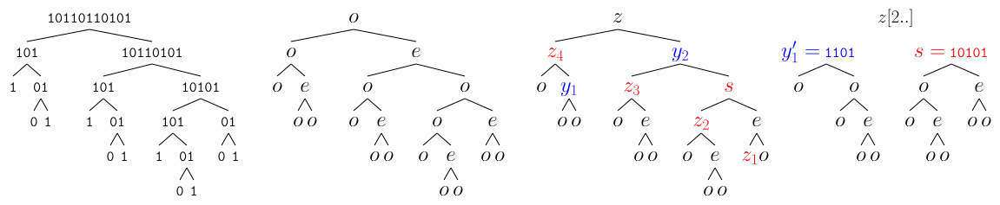
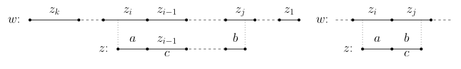
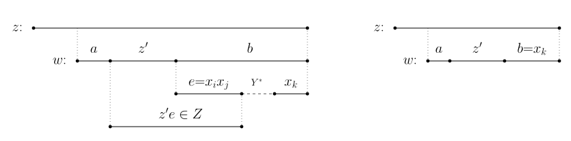
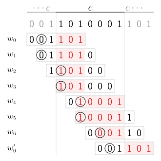
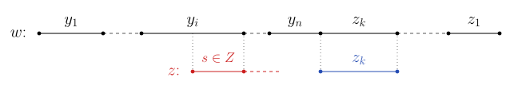
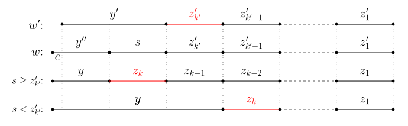

#+title: Optimal sampling schemes for w=2 and odd k
#+filetags: wip minimizers
#+OPTIONS: ^:{} num:2
#+hugo_front_matter_key_replace: author>authors
#+toc: headlines 3
#+hugo_level_offset: 1
#+date: <2026-10-15 Thu>

$$
\newcommand{\im}{\mathsf{im}}
\newcommand{\sign}{\mathsf{sign}}
\newcommand{\dbg}[1]{\mathsf{DBg}_{#1}}
\newcommand{\dbgn}{\dbg{n}}
\newcommand{\idn}{\alpha}
\newcommand{\abs}[1]{|#1|}
\newcommand{\mc}{\mathsf{maxcut}}
\newcommand{\mdc}{\mathsf{maxdicut}}
\newcommand{\density}{\mathsf{density}}
$$

(This is a work-in-progress paper draft. See also the accompanying [[./optimal-sampling-notes.org][notes]].)

---

* Abstract
* Introduction
- connection between DBg, minimizers, independence numbers

- TODO: framing from graph perspective; with application to w=2 minimizers

- Relation to SUS-anchors and 10-minimizers
- TODO: what about $w=2$ and even $k$ or even $n$ with $\sigma=2$
- TODO: investigate potential journals
- TODO: cite previous work on DBg independence number
- TODO: some result to extend to larger alphabets
  - https://shop.elsevier.com/books/sequences-and-the-de-bruijn-graph/etzion/978-0-443-13517-0
- TODO: Read "Sequences and the de Bruijn Graph" pdf

** Previous work on DBg independence number
** Previous work on minimizers
- density
- lower bound
- equivalence to density on cycles
- equivalence to density on random contexts
  
* Preliminaries
** De Bruin graphs
*Notation.*
We consider strings (or words) over an *alphabet* $A$ of size $\sigma$.
A *\(k\)-mer* is a string of length $k$.
For $x\in A^n$, we write $x=x_0\dots x_{n-1}$, and prefix and suffix *substrings* are denoted by $x[\ell..) = x_\ell \dots
x_{n-1}$, $x[..r) = x_0\dots x_{r-1}$.
We write $d|n$ when $d$ divides $n$.
The set $[n]=\{0,\dots,n-1\}$ is the set of 0-based indices.

#+name: notation
#+caption: A summary of some variables introduced here.
#+attr_html: :class small
| Variable | Meaning                                   |
| $A$      | Alphabet of size $\sigma=\abs{A}$.        |
| $\idn$   | Independence number.                      |
| $\dbgn$  | De  Bruijn graph with nodes $A^n$.        |
| $\ell_n$ | Number of primitive words of length $n$.  |
| $Z_n$    | Number of conjugacy classes of words of length $n$. |

*De Bruijn graph.*
We start by introducing the De Bruijn graph of order $n$ [CITE], $\dbgn$.
Over an alphabet $A$, its vertices are given by the set of all strings of length
$n$, that is, $V =V(\dbgn) := A^n$. The /directed/ edges correspond to
/consecutive/ \(n\)-mers that overlap in $n-1$ characters:
$E = E(\dbgn) := \{(y[..n), y[1..)) : y\in A^{n+1}\}$.

The edges of $\dbgn$ correspond to \(n+1\)-mers, and thus are in bijection with
the vertices of $\dbg{n+1}$, and more generally $\dbg{n+1}$ is the /line graph/ of $\dbgn$.

*Conjugacy classes.*
Before proceeding, recall that two strings $x$ and $y$ are /conjugates/ if one is a rotation of the
other, that is, $y = x[i..)x[..i)$ for some $i\in [n]$.
Thus, the set of strings of length $n$ can be partitioned into /conjugacy
classes/ of strings that are each others rotation.
Each conjugacy class is also called a /necklace/ as it considers the cyclic
string obtained by "tying together" the two ends of a string.
An \(n\)-mer $x$ is *primitive* if all its rotations are distinct and its conjugacy
class has size $n$.
Otherwise, the *period* is $p>1$, which is the largest integer such that $x=y^p$ for
some $y$.

*Counting primitive words.*
If $\ell_n$ counts the number of conjugacy classes of primitive strings (i.e. necklaces) of length $n$ (for alphabet
size $\sigma$), then
$$\sigma^n = \sum_{d|n} d\ell_d.$$
To see this, there is a bijection between all strings of length $n$ on the left,
and $p=n/d$ copies of a primitive string of length $d$ on the right, offset
(rotated) by $\{0, \dots, d-1\}$ positions.
The number of (conjugacy classes of) primitive words of length $n$ now follows directly
from Möbius inversion [CITE original] [cite:@codes-and-automata prop 1.3.5]:
$$
\ell_n = \frac 1n \sum_{d|n} \mu(n/d) \sigma^d,
$$
where $\mu(p)$ is the Möbius function that is the multiplicative function
that is $-1$ for primes and $0$ for larger powers of primes. Thus, it is zero
when a square $>1$ divides $p$ and otherwise the parity of the number of prime factors.

*Counting conjugacy classes.*
The total number of conjugacy classes $Z_n$ of words of length $n$ is given by summing over all divisors of
$n$:
$$
Z_n
= \sum_{n' | n} \ell_{n'}
= \sum_{n'|n} \frac 1{n'}\sum_{d|n'} \mu(n'/d) \sigma^d 
= \frac 1n \sum_{d|n} \sigma^d \sum_{n': d|n'|n} \frac n{n'} \mu(n'/d)
= \frac 1n \sum_{d|n} \phi(d)\sigma^d,
$$
where $\phi(d)$ counts the number of integers up to $d$ that are coprime with $d$.

*Vertex partition.*
De Bruijn graphs have many nice properties.
For example, the strings of length $n$ can naturally be partitioned into
$Z_n$ *conjugacy classes* of strings that are equivalent under rotation.
This partition naturally extends to the vertices of $\dbgn$, so that we have a
vertex partition of $V_n$ into disjoint cycles.
For each $d|n$, the number of parts with $d$ vertices matches $\ell_d$.

*Edge partition.*
There is a natural bijection $V_n \equiv E_{n-1}$, where vertices
of $\dbgn$ correspond to an edges between two \(n-1\)-mers in $\dbg{n-1}$.
This way, the vertex partition of $\dbgn$ extends to a partitioning of the edges of
$\dbg{n-1}$ into $Z_n$ cycles that all have length dividing $n$ and correspond
to the projection of a cyclic string of length $n$.

*TODO figure for $n=3$ or $n=5$.*

*Decycling sets.*
[cite/t:@shift-register-sequences] considered the maximum number of vertex
disjoint cycles in $\dbgn$, and conjectured this to be equal to the trivial
lower bound $Z_n$.
[cite/t:@lempel71] considers the minimum size of a /decycling set/, a set of
vertices that, when removed from $\dbgn$, makes the graph acyclic. This is
trivially lower bounded by the previous quantity, and Lempel conjectures that it also
equals $Z_n$.
[cite/t:@mykkeltveit] later proved both these conjectures: one can remove one
vertex from every conjugacy class-induced cycle such that the remaining graph
becomes acyclic.

Note that even though $Z_n$ vertices can be removed to make $\dbgn$ acyclic, the
graph does still contain undirected cycles.

** The independence number
An *independent set* of a graph is a subset of vertices $S\subset V$ such that
no two elements of $S$ are adjacent, i.e. $S^2\cap E = \emptyset$.
The *independence number* $\idn(G)$ of a graph is the size of the largest
independent set[fn::Some papers use $\alpha(G)$ for the independence number of
the graph with self-loops removed, and $\alpha^*(G)$ for the independence number
where vertices with self-loops are not allowed. We use $\alpha(G)$ for the latter.].

There are a number of previous results on the independence number of De Bruijn
graphs.
[cite/t:@dbg-independence-number] determines the exact value of $\idn(\dbgn(\sigma))$
for $n=2$ and arbitrary $\sigma$,
and for $\sigma=2$ and $n\leq 7$. He proves a an upper bound for odd primes
$n$:
$$
\idn(\dbgn) \leq \frac{(n-1)(\sigma^n-\sigma)}{2n} = \frac {n-1}2 \ell_n,
$$
which corresponds to taking $(n-1)/2$ mostly alternating vertices in each of the odd length $n$ cycles.
He conjectures that this bound is tight.
He also shows that $\lim_{n\to\infty}\idn(\dbgn)/2^n  = 1/2$.
More recently, [cite/t:@dbg-independence-number-26] extended these results
to show that equality holds for the primes $\{11, 13, 17\}$ (for arbitrary $\sigma$).
Additionally, they give asymptotic bounds showing that $\idn(\dbgn(\sigma)) = \Theta(\sigma^n)$.
Independently, [cite/t:@dbg-independence-n3] studied the case $n=3$ and derive a generating function for $\alpha(\dbg3(\sigma))$.

Here, we note again that an independent set of vertices of $\dbgn$ corresponds to an
independent (non-touching) set of /edges/ of $\dbg{n-1}$.

[Drop?]
Adjacent work includes that of [cite/t:@necklace-matching], who show that for odd $n$ there is a
matching on the /necklace graph/, and [cite/t:@covering-dbg], who investigate
bounds on the size of independent sets that /cover/ the graph, i.e. such that
every vertex is adjacent to the independent set.

** Independent sets, vertex covers, and max cuts
A maximum independent set $S$ never contains both ends of an edge. Thus, the
complement $S'=V-S$ contains at least one end of every edge, so that this is a
/minimum vertex cover/. 

[TODO: I don't think we actually use vertex covers, but doesn't hurt to keep
them for understanding.]

Let $V_0\cup V_1 = V(\dbg{n-1})$ be a partition of the vertices of $\dbg{n-1}$.
We can associate this with a labelling function $\lambda: V\to \{0,1\}$ mapping each
vertex to its part.
A /cut/ $C_\lambda$ is the set of edges between $V_0$ and $V_1$: $C_\lambda:=\{uv\in
E: \lambda(u)\neq \lambda(v)\}$. A /directed cut/ is the set of directed edges
from $V_1$ to $V_0$.[fn::We choose this direction to be consistent with
minimizer schemes later on.]
The /maximum (directed) cut/ is the largest (directed) cut that can be obtained,
and their sizes are denoted by $\mc(G)$ and $\mdc(G)$.
Since the De Bruijn graph is connected and every node in it has in-degree and out-degree $\sigma$, the graph is Eulerian.
This implies that for every cut, the number of directed edges from $V_0$ to $V_1$ equals
the number of directed edges from $V_1$ to $V_0$, and thus, that the directed cut is half
the size of the (undirected) cut:
$$\mdc(\dbg{n-1}) = \frac 12 \mc(\dbg{n-1}).$$

As observed by [cite/t:@maxcut-equivalence] in the more general setting of line graphs,
a directed max-cut of $\dbg{n-1}$ directly corresponds to an independent set of $\dbgn$, i.e.,
$$\mdc(\dbg{n-1})=\idn(\dbgn).$$

As we already saw, the edges of $\dbg{n-1}$ can be partitioned into $Z_n$ cycles
corresponding to the conjugacy classes of primitive words of length dividing $n$.
When $n$ is odd, all these cycles have odd length.
Thus, for any partition $\lambda$, there must be at least one uncut edge $uv$ 
with $\lambda(u)=\lambda(v)$ in each cycle.
It follows that the maximum size of a cut is
$$\mc(\dbg{n-1}) \leq \sigma^n-Z_n$$
and thus that
$$\idn(\dbgn) = \mdc(\dbg{n-1}) \leq \frac {\sigma^n - Z_n}2,$$
where equality is reached if and only if every projected $n$-cycle in
$\dbg{n-1}$ contains exactly one uncut edge.

*Conjecture.*
Since this bound matches the earlier exact results for small odd primes,
it is natural to conjecture that in fact this bound is tight for all odd
$n$, and indeed this is what we will prove.[fn::To our knowledge, this
conjecture has not been stated as such in previous work.]

Conceptually, it is interesting that when $n$ is odd, this relates $Z_n$, which
count the /number/ of cycles, to $\idn(\dbgn)$, which instead relates to (half)
the total /length/ of the cycles.

*TODO fig*

** Sampling schemes

We now have a look at the relation to /sampling schemes/ [TODO cite more?], which slightly
generalize the more commonly known /minimizer schemes/ [cite:@winnowing;@minimizers].
Given a \(k\)-mer size $k$ and a /window size/ $w$, a /window/ is a string of
length $\ell:=k+w-1$ containing $w$ \(k\)-mers. A sampling scheme then is a
function $f: A^\ell \to \{0,\dots,w-1\}$ that for each window chooses one
specific \(k\)-mer. A sampling scheme is /forward/ when adjacent windows $W$ and
$W'$ (i.e., adjacent vertices in $\dbg\ell$) satisfy $f(w') \geq f(w)-1$, so
that the sampled \(k\)-mer never jumps backwards.
The /density/ of a forward sampling scheme is the fraction of /charged/ edges $WW'$ in
$\dbg\ell$ for which $f(W')\neq f(W)-1$ [CITATIONS MARCAIS].
[cite/t:@sampling-lower-bound] have shown that
$$
\density(f) \geq \frac1{\sigma^{k+w}} \sum_{d | (k+w)} \ell_d\cdot \left \lceil \frac dw\right\rceil.
$$
The main insight is that for $n=k+w$, the edges of $\dbgn$ partition into
$\ell_d$ cycles of length $d|n$, and along each cycle, there can be at most
$w-1$ consecutive "free" edges where $f(W)$ decreases by $1$, so that the number
of charged edges on each length-\(d\) cycle is at least $\lceil d/w\rceil$.

Based on brute-force results for small parameters, they conjectured that when
$k\equiv 1\pmod w$, there exists a forward sampling scheme that achieves this
density lower bound.
The connection to independent sets should now be clear: if we take $w=2$ and $n=k+1$, then
$f: \sigma^{w+k-1}\to \{0,\dots,w-1\}$ turns $f: \sigma^n\to \{0,1\}$ and
becomes equivalent to the partition function $\lambda$.
Furthermore, minimizing the number of charged edges with $f(W')\neq f(W)-1$ is
then equivalent to maximizing the number of edges $uv$ in the directed max cut (or
independent set of edges) with $\lambda(u)=1$ and $\lambda(v)=0$:
$$
\sigma^n \cdot \density(f) + \textsf{dicut}(f) = \sigma^n 
$$

For this $w=2$ case, the conjecture assumes that $k=n-2$ is odd, i.e. that $n$
itself is odd. We then have $\lceil d/w\rceil = \lceil d/2\rceil = \frac{d+1}2$.
Given that $\sum_{d|n}d\ell_d = \sigma^n$ and $\sum_{d|n}\ell_d=Z_n$, the conjecture becomes
$$
\idn(\dbgn)
= \mdc(\dbg{n-1})
\leq \sigma^n - \sum_{d|n} \ell_d \cdot \left\lceil \frac d2\right\rceil
= \sigma^n - \sum_{d|n} \ell_d \cdot \frac{d+1}2
= \frac{\sigma^n - Z_n}2,
$$
which indeed matches the conjecture of the previous section.

The small results of [cite/t:@sampling-lower-bound] suggest that
in addition to /odd/ $k$ and $n$, the bound holds for /all/ $k$ and $n$ when $w=\sigma=2$.

In the context of sampling and minimizer schemes, $f$ is usually defined as a
"local" function taking only the window $W\in A^\ell$, without and global state.
Thus, ideally the goal is to find a "clean" or "pure" function $f$ (or $\lambda$) that achieves
this lower bound on the density.
In contrast, we typically think of an independent set as a global
solution to an optimization problem, and not every independent set will
naturally correspond to a local sampling scheme.

* Mykkeltveit embedding
** The classical Mykkeltveit embedding

*TODO* Explain why this decycling

The Mykkeltveit embedding was introduced by [cite/t:@mykkeltveit] in order to
prove a conjecture of Lempel [cite:@lempel71] stating that the order-\(n\) De Bruijn graph $B_n$
can be made acyclic by removing $Z(n)$ vertices. In particular, it is clear that
$Z(n)$, the number of disjoint cycles is $Z(n)$ and thus that this is a lower bound.

In particular, a node $w=w_0\dots w_{n-1}$ of the De Bruijn graph is mapped to
\begin{equation*}
f(w) = \sum_{i=0}^{n-1} w_i \cdot \omega^i,
\end{equation*}
where $\omega=\omega_n$ is the complex \(n\)-th root of unity.
The Mykkeltveit decycling set [cite:@minimum-decycling-set] then consists of all
words with $\pi-2\pi/n \leq \arg(f(w)) < \pi$, i.e., those words that are the
first rotation having positive imaginary part.

** A new embedding
We want to build on optimal $w=2$ minimizer scheme for some odd $k$.
Thus, we must build a function from a length-\(k+1\) window $w=w_1\dots w_{k+1}$
to $\{0,1\}$. [todo].

Let $n=k+2$ be odd and now let $\omega=\omega_{2n}$ be a $2n$'th root of unity so that
$(-\omega)^n=-\omega^n = 1$.
We define
\begin{equation*}
g(w) = \sum_{i=1}^{n-1} w_i (-\omega)^i,
\end{equation*}
where the $(-\omega)^0$ term is skipped.
Like Mykkeltveit, we choose the first or second \(k\)-mer based on the sign of the imaginary part of $g(w)$, $\sign(\im(g(w)))$.

Now consider a primitive cyclic context $c=c_0\dots c_{n-1}$ of length $n=k+2$ and the $n$ windows $w_1$ to $w_n$
contained in it, with $w_j = c_{j}\dots c_{j+n-2}$ with indices modulo $n$.
Then
\begin{align*}
\im(g(w_j))
&= \im(g(c_{j}\dots c_{j+n-2}))
 = \im\left(\sum_{i=1}^{n-1} c_{j+i} (-\omega)^i\right)
 = \im\left(\sum_{i=0}^{n-1} c_{j+i} (-\omega)^i\right)\\
&= \im\left((-\omega)^{-j}\sum_{i=0}^{n-1} c_{j+i} (-\omega)^{i+j}\right)
 = \im((-\omega)^{-j}g(w_0)).
\end{align*}

Assuming that $g(w_0)\neq 0$, $(-\omega)^n g(w_0)$ changes imaginary sign $n-1$
out of $n$ times. Thus, for all but one pair of consecutive windows we choose
"synchronized" \(k\)-mers. [todo this "big picture stuff" needs to be more precise.]

[todo: distinguish $n$ and $d|n$ for shorter primitive contexts?]

[todo: what if $g(w_0)=0$? Note that $g(w_0)=0$ for periodic sequences.]

** Degenerate and non-primitive cases
:PROPERTIES:
:CUSTOM_ID: mykkeltveit
:END:
A (primitive?) cycle $c$ is /degenerate/ when $g(c)=0$.

Lemma: distinct degenerate cycles are vertex (window)-disjoint, so we can simply
"hardcode" an alternating order.

Dfn: we can make that order comparible: if $\im(g(w))=0$ but no extended context
has $g(c)=0$, then set $\lambda_0(w)=0$ (Bryce's notation).
Otherwise, let $a$ be the unique such symbol, and anchor by the
lexicographically smallest rotation.

(Importantly, we should make sure this is compatible with the choice in the
non-degenerate case.)

* Comma-free codes
** Previous work on comma-free codes
We will now consider a completely different approach to solving our problem of
finding an optimal minimizer scheme, or equivalently a vertex(?) cover of the De
Bruijn graph.
Our construction closely builds on existing work to build /comma-free codes/,
which are specific /codes/ (sets of words) such that no other code words can be
found in the overlap between two code words.
Comma-free codes were first introduced by
[cite/t:@codes-without-commas] as a (wrongly) hypothesized structure of the amino acids to
avoid reading-frame issues. [cite/t:@comma-free-codes-golomb] find
comma-free codes of maximal size for odd $k$ up to 15 and show that,
in general, optimality is not possible for even $k$.
[cite/t:@comma-free-codes-eastman] is the first to show a construction for all odd
$k$. Their presentation is quite intricate.
[cite/t:@knuth-taocp4-5b-backtracking] gives a significantly simpler
presentation in terms of /dips/, which are locally maximal subsequences $w=w_1\dots w_k$ with
$w_1\geq\dots\geq w_{k-1}<w_k$. Given a cyclic word, one then finds all
odd-length dips and splits the word before each odd-length dip, and proceeds
recursively on these substrings.
[cite/t:@comma-free-codes-perrin] further improve terminology with /superdips/
(an odd-length dip followed by even-length dips) and \(n\)-(super)dips, which
are (super)dips over the alphabet of \((n-1)\)-dips using the radix order.

Meanwhile, [cite/t:@comma-free-codes-scholtz] provides a simpler technique to
create a maximal-size comma-free codes that is initially explained in terms of
"erasing commas between tokens". Again, the presentation was significantly
simplified in terms of Lazard sets
[cite:@lazard60;@codes-and-automata] by [cite/t:@comma-free-codes-perrin]. 
Their main theorem shows that the Eastman construction also arises as a Lazard set.

Lastly, a helpful algorithm is that of Melancon [cite:@melancon-thesis;@comma-free-codes-perrin;@codes-and-automata], which
gives a general bottom-up procedure similar to the ones of Knuth and Scholtz to
find the conjugate of a word that is part of the comma-free code.

** Hall Sequences, Lazard Sets, and Comma-Free Codes
Our presentation will closely follow Section 7.3 and Chapter 8 of
[cite/t:@codes-and-automata] and definitions and lemmas are taken from there
unless otherwise mentioned.
Further background can be found in [cite/t:@free-lie-algebras-reutenauer] and [cite/t:@free-lie-algebras-viennot].

*Notation.*
We write $A$ for the alphabet use $u\in  A^*$ for /words/ over $A$. A word can
be seen both as a string of characters as well as an element of the free monoid
over $A$. The empty word is written $1$, and $A^{\leq n}$ is the set of words of
length up to $n$.
The characters of a word are indexed counting from 0, and the suffix starting at
the $i$'th $0$-based character is denoted $w[i..]$.
The /radix order/ $u<_rv$ compares words $u$
and $v$ first by length $|u|<|v|$, and breaks ties lexicographically.
Two words $w$ and $w'$ are /conjugate/ when they are a rotation of each other,
i.e. there are $u$ and $v$ such that $w=uv$ and $w'=vu$.
A word is /primitive/ when it is not the power of some other word.
A /strict/ prefix (suffix) of a word is a prefix (suffix) that does not equal
the word itself.

We now move on to re-stating some relevant definitions.
# Originally Hall sets are defined in terms of trees [cite:@free-lie-algebras-reutenauer], but here we take a simpler definition.

*TODO Example*

# *TODO drop hall sequence; replace by remark*

# #+begin_definition Hall sequence [7.3]
# A sequence $(x_i)_{i\geq 1}$ of words is a /Hall sequence/ if it is obtained via
# the following /elimination/ procedure[fn::The is some conflict here whether $|x_{i+1}|\geq |x_i|$ is needed???]
# #+end_definition

One of the core concepts underlying this section is the /Lazard set/
[cite:@lazard60], that provides a specific total order on a subset $Z$ of $A^+$.
This uses the /Lazard elimination/ process, which repeatedly removes the
smallest (according to some order) element from some set $X_i$ and then updates
$X_i$ to $X_{i+1}$.
However, since there could be infinitely many strings smaller than any particular
element (such as /all/ strings starting with 0 being smaller than the string 1),
the definition below restricts to finite-length
strings[fn::I remain confused. The definition [7.3] of a Hall set requires $|x_i|
\leq |x_{i+1}|$, but Lazard sets do not require this. If this was indeed a
requirement, than it wouldn't be necessary to restrict to finite-length
elements, since there are only finitely many shorter (finite-length) strings
smaller than given string].

#+begin_definition Lazard set [8.1]
A /Lazard set/ is a totally ordered subset $Z$ of $A^+$ such that for each
$n\geq 1$, the elements of length at most $n$ can be obtained via
/Lazard elimination/:
Let $Z\cap A^{\leq n} = \{x_1,\dots,x_k\}$ be totally ordered with $x_1<x_2<\dots<x_k$.
Then, starting with $X_1=A$, we have $x_i\in X_i$ where $X_{i+1} := x_i^*
(X_i\backslash x_i)$ and when $X_{k+1} \cap A^{\leq n} = \emptyset$.
#+end_definition
Lazard sets are equivalent to /Hall sets/ [cite:@codes-and-automata dfn 7.3], where the $x_i\in
X_i$ can be chosen freely
[cite:@free-lie-algebras-reutenauer,thm 4.18].

#+begin_example Lyndon words
Consider the binary alphabet and start with $X_1 = \{a,b\}$, and
we repeatedly take $x_i$ as the lexicographically smallest element, and consider the words of length up to $n=5$. Then, the $x_i$ are exactly the set of /Lyndon words/ of the minimal rotation of all primitive words.
\begin{align*}
x_1&=a & X_2 \cap A^{\leq 5} &= \{aaaab,aaab,aab,ab,b\}\\
x_2&=aaaab & X_3 \cap A^{\leq 5} &= \{aaab,aab,ab,b\}\\
x_3&=aaab & X_4 \cap A^{\leq 5} &= \{aaabb,aab,ab,b\}\\
x_4&=aaabb & X_5 \cap A^{\leq 5} &= \{aab,ab,b\}\\
x_5&=aab & X_6 \cap A^{\leq 5} &= \{aabab,aabb,ab,b\}\\
x_6&=aabab & X_7 \cap A^{\leq 5} &= \{aabb,ab,b\}\\
x_7&=aabb & X_8 \cap A^{\leq 5} &= \{aabbb,ab,b\}\\
x_8&=aabbb & X_9 \cap A^{\leq 5} &= \{ab,b\}\\
x_9&=ab & X_{10} \cap A^{\leq 5} &= \{abb,b\}\\
x_{10}&=abb & X_{11} \cap A^{\leq 5} &= \{abbb,b\}\\
x_{11}&=abbb & X_{12} \cap A^{\leq 5} &= \{abbbb,b\}\\
x_{12}&=abbbb & X_{13} \cap A^{\leq 5} &= \{b\}\\
x_{13}&=b & X_{14} \cap A^{\leq 5} &= \{\}.
\end{align*}
#+end_example

We note that there is an equivalence between /strings/, as a concatenation of
characters from an alphabet, and /words/ in a free algebra, as a free product of
the generating elements. Indeed most of the theory in this section was developed
in the context of these free algebras, and there are corresponding results like a /unique
factorization/.

# *TODO write more about $\nu$ and $\delta$*

# #+begin_lemma Unique factorization [8.1.10]
# For any Lazard set $Z$, the family $(z)_{z\in Z}$ is a /complete factorization/ of
# $A^*$, meaning that every $w\in A^*$ can be uniquely written as $w=z_k\dots z_1$
# with $z_i\in Z$ and $z_k \geq \dots \geq z_1$.
# #+end_lemma

The following construction is a modern presentation by
[cite/t:@comma-free-codes-perrin 3.3;@codes-and-automata] of Scholtz' original "comma
erasing method" [cite:@comma-free-codes-scholtz].
#+begin_definition Scholtz construction [eq 7.21]
Let $(x_i)_{i\geq 1}$ and $(X_i)_{i\geq 1}$ be the Hall sequence obtained by
choosing $x_i \in X_i$ as some word of minimal /odd/ length.
Define
\begin{align*}
U&=\bigcup_{i\geq 1}X_i,
&
Y&=U\cap (A^2)^*
&
Z&=U\cap A(A^2)^*,
\end{align*}
so that $Y\cup Z = U \subseteq A^+$.
$Z = \{x_1, x_2, \dots\}$ is the set of /code words/, consisting of all
odd-length elements of $U$. $Y$ contains the even-length elements of $U$ that
never appear as an $x_i$.

The procedure can be extended to also eliminate all even-length elements [8.1.9].
Then $U$ is a Lazard set ordered via $u<v$ if $|u|$ is odd and $|v|$ is even, or if they have the
same parity and $u<_{r} v$ for the radix order.

For $u\in U$, define
\begin{align*}
\nu(u) &= \min\{i\in \mathbb N | u\in X_i\} -1\\
\delta(u) &= \sup\{i\in \mathbb N | u\in X_i\}
\end{align*}
Thus, the time that $u\in A^+$ is first "created" is denoted by $\nu(u)$, so that $u =
x_{\nu(u)}^+v \in X_{\nu(u)+1}$ for some $v\in X_{\nu(u)}$.
For odd-length $u\in Z$, $\delta(u)=i$ indicates that $u=x_i$, while for
even-length $u\in Y$, $\delta(u) = \infty$ because even-length words are never
removed from any $X_i$.[fn::Considering $U$ as a Lazard set, one only considers
finite-length strings in which case even-length elements /are/ eventually
eliminated. But here the $X_i$ contain arbitrary long sequences, and so we only
ever eliminate odd-length elements.]
#+end_definition

From here on, $x_i\in X_i$, $Y$, and $Z$ all refer to this specific
construction, and for $u,v\in U$ we write $u<v$ as ordered by the Lazard set. In
particular, for $x_i,x_j\in Z$ we have $x_i<x_j$ iff $i<j$.

We now cover some basic facts about this construction and the sets $U$, $Y$, and $Z$.

We again consider an example with this new order, showing the Lazard elimination
of strings of length at most $5$ in $U$. We start with $X_1=\{a,b\}$.
\begin{align*}
x_1&=a & X_2 \cap A^{\leq 5} &= \{b, ab, aab, aaab, aaaab\}\\
x_2&=b & X_3 \cap A^{\leq 5} &= \{ab, bab, aab, aaab, baab, bbab, aaaab, baaab, bbbab\}\\
x_3&=aab & X_4 \cap A^{\leq 5} &= \{ab, bab, aaab, baab, bbab, aaaab, aabab, baaab, bbbab\}\\
x_4&=bab & X_5 \cap A^{\leq 5} &= \{ab, aaab, baab, bbab, aaaab, aabab, baaab, babab, bbbab\}\\
x_5&=aaaab & X_6 \cap A^{\leq 5} &= \{ab, aaab, baab, bbab, aabab, baaab, babab, bbbab\}\\
x_6&=aabab & X_7 \cap A^{\leq 5} &= \{ab, aaab, baab, bbab, baaab, babab, bbbab\}\\
x_7&=baaab & X_8 \cap A^{\leq 5} &= \{ab, aaab, baab, bbab, babab, bbbab\}\\
x_8&=babab & X_9 \cap A^{\leq 5} &= \{ab, aaab, baab, bbab, bbbab\}\\
x_9&=bbbab & X_{10} \cap A^{\leq 5} &= \{ab, aaab, baab, bbab\}\\
y_1&=ab & X_{11} \cap A^{\leq 5} &= \{aaab, baab, bbab\}\\
y_2&=aaab & X_{12} \cap A^{\leq 5} &= \{baab, bbab\}\\
y_3&=baab & X_{13} \cap A^{\leq 5} &= \{bbab\}\\
y_4&=bbab & X_{14} \cap A^{\leq 5} &= \{\}
\end{align*}
Note again that $Z=\{x_1,\dots\}$ is the subset of odd-length words of $U$, while
$Y=\{y_1,\dots\}$ is the subset of even-length words.
We have $\nu(baaab)=2$ since $baaab=(b)(aaab) = x_2 v$ with $v=aaab\in X_2$.
Similarly, we have $\delta(baaab)=7$ since $x_7=baaab$.
On the other hand, $\delta(baab)=\infty$ since $baab\not\in Z$, even though
$baab$ is an element of the Lazard set $U$.

# *TODO add more explaining text here*

#+begin_lemma Some facts [eq 7.22 sec 7.3.15]
If $u\in U\backslash A$, then $u=x_{\nu(u)}^+v$ for $v\in X_{\nu(u)}$, or alternatively,
$$u=x_{\nu(u)}v' \quad \text{ for }v'\in X_{\nu(u)+1}.$$
Furthermore, $u\not\in X_{\nu(u)}$.

For all $x_i \in Z$ and $u\in U$ we have
\begin{equation*}
\nu(u)\leq i<\delta(u) \implies x_iu\in U,
\end{equation*}
where the condition is equivalent to $u\in X_{i+1}$.

For all $i<j$, $x_ix_j\in Y^*$.

For all $z\in Z$ and $y\in Y*$, $zy\in Y^*Z$.
#+end_lemma

#+name: factor-tree
#+caption: Every word $u\in U$ corresponds to a unique factorization tree. On the left, the code word $z=10110110101\in Z$ of odd length is factorized. In the middle, $o$ and $e$ indicate words of odd and even length. The left factor is always some odd-length $x_i\in Z$ and the right factor some $u\in U$ with opposite parity from the current node. The third figure shows that the suffix of $z$ factorizes into even-length components as $y_1y_2=01\cdot10110101$ and that the prefix of $z$ factorizes as $z_4z_3z_2z_1=101\cdot101\cdot101\cdot0$, matching [[lem:pref]] and [[lem:suf]]. On the very right, the factorization of $z[2..] = 1101\cdot 10101$ is shown. Note that while $s=10101$ also occurs in the original factorization of $z$, $y'_1=1101$ does not.
#+attr_html: :class large

As an example, consider [[factor-tree]], showing how $z=10110110101\in Z$ is
recursively built from smaller elements of $U$. The root $z$ itself has odd
length, and each non-leaf node $u=x_iu'$ is made by concatenating some $x_i\in Z$ of odd length
(the left branch) with some $u'\in U$ with length of opposite parity of $u$ with
$x_i < u'$. As we will see below, every prefix of $z$ corresponds to the
concatenation of a number of decreasing odd-length $z_i\in Z$, as shown in red, while every
suffix of $z$ corresponds to a number of even-length $y\in Y$, as shown in blue,
possibly followed by one odd-length factor $s\in Z$.
An algorithm to build this tree given any $u\in U$ is Melancon's algorithm [[dfn:melancon]]

Although we won't directly use this fact here, the main point of all this theory
is to develop a maximal /comma-free code/:
#+begin_definition Comma-free code
A code $X\subseteq A^m$ is a /comma free code/ when no word of $X$ overlaps
nontrivially with a product (concatenation) of two words of $X$. That is, given
$x_1,x_2\in X$ with $x_1=ab$ and $x_2=cd$ with $b\neq 1$ and $c\neq 1$, then
$bc\not\in X$.
#+end_definition
For any $x\in X$, $xx$ may contain only $x$ itself as code word of length $m$, so that $X$
contains at most one element of every conjugacy class. Thus, $|X|\leq
\ell_m(k)$, which counts the number of conjugacy classes of words of length $m$
over an alphabet of size $k$ (or equivalently, the number of primitive words
with length dividing $m$).

*TODO: Define and detangle $\ell_m(k)$, the number of primitive words of length
$m$ over alphabet $k$, and the total number of conjugacy classes of words of
length $m$*

#+begin_theorem Maximal comma-free code [7.3.11]
For odd $n$, $Z\cap A^n$ is a comma-free code of maximal size $\ell_n(k)$.
[ *TODO*: do we use $n$ or $m$ for the length here? Make this consistent.]
#+end_theorem

What this means is that comma-free codes provide a way to sample a
representative from every conjugacy class, i.e., they sample one vertex in every
primitive length \(n=k+2\) cycle in the order $n$ De Bruijn graph.
[ *TODO* Or do we look at edges in the order $n-1$ DBg?]

We won't repeat the proof here, but do re-state a few lemmas that will be useful
to us later.

#+begin_lemma [7.3.6]
Each $X_i$ is a /maximal prefix code/: for all distinct $x,x'\in X_i$, $x$ is not a
prefix of $x'$, and for each word $w\in A^*$, there is at most one way to write
it as a product of elements of $X_i$.
Furthermore, each primitive word $w$ with $|w|>|x_i|$ has a conjugate in $X_{i+1}^*$
#+end_lemma

# One of the core lemmas is the following, which follows directly from the more
# general unique factorization lemma mentioned above:

# *TODO even terms are large*

# #+begin_lemma Unique factorization [8.1.10]
# For any Lazard set $Z$, the family $(z)_{z\in Z}$ is a /complete factorization/ of
# $A^*$, meaning that every $w\in A^*$ can be uniquely written as $w=z_k\dots z_1$
# with $z_i\in Z$ and $z_k \geq \dots \geq z_1$.
# #+end_lemma

Any Lazard set implies a unique factorization on $A^*$ [8.1.10]. In our case, where
we consider even-length words separately, we get the following.

#+begin_lemma Unique factorization [7.3.13] :label unique
Each word $w\in A^*$ has a unique factorization
$$
w=yz_k\dots z_1
$$
with $y\in Y^*$, $z_i\in Z$, $n\geq 0$ and $z_k\geq \dots\geq z_1$.
#+end_lemma
Some implications are the following.
#+begin_lemma Prefix factorization [7.3.14] :label pref
For a proper prefix $w$ of a word in $U$, the factorization has $y=1$, i.e.,
$w=z_k\dots z_1$.
#+end_lemma
#+begin_lemma Suffix factorization [7.3.16] :label suf
For a proper suffix $w$ of a word in $U$, the factorization has $n=0$ or $n=1$
(depending on the parity of $|w|$), i.e., $w=y$ or $w=yz$ for some $y\in Y^*$
and $z\in Z$.
#+end_lemma
#+begin_lemma Overlapping code words [Proof of 7.3.11] :label overlap
Let $u,v\in U$ be two words that overlap as $u=ab$ and $v=bc$ with $a,b,c\neq
1$. Then $b$ is a code word in $Z$.
In particular, for $z_0,z_1\in Z$, $z_0z_1$ does not contain a non-trivial word in its overlap.
#+end_lemma
#+begin_proof
$b$ is both a prefix and a suffix of a code word in $U$. Thus
$b=yz_1\dots z_n$ with $y=1$ and $n\in\{0,1\}$, so $b=z_1$ since $b\neq 1$.

Suppose that $z_0z_1$ contains a word $z$ in its overlap. Then the overlap $a$ with
$z_0$ is a code word and the overlap $b$ with $z_1$ is a code word, but $z$ has
odd length and $ab$ has even length, so this is impossible.
#+end_proof

** Intuition

The last lemma tells us that there is, in fact, a lot more structure to our
comma-free code than just "one sample per conjugacy class": 
Any time two code words overlap, or in the graph setting, that there is a path
from sampled vertex $u$ to sampled vertex $v$ of length $<n$, this path has
length $n-|b|$, which is even. Thus, looking modulo two, $u$ and $v$ are "synchronized".
In particular, given a long string, we can consider the subset of \(n\)-mers
that is a code word. If we look at two consecutive code words (not necessarily
adjacent \(n\)-mers), they are either synchronized, or non-overlapping. 

So far, this argument does not yet give us a way to take a sample from every
context, since some strings may not contain any code word.
Instead, we can, for every \(n\)-mer in our string, mark the position/character that
starts its code word conjugate.
Now suppose we have a string that starts in a code word $c$, and consider the first
$n$ \(n\)-mers, each of which overlapping a suffix of $c$. Then, if they sample
a position within $c$ (in the first $n$ characters of the string), this position
must be even by the previous lemma.

The remaining question is: what happens in overlapping non-code word context?
In this case, the second code word is not an extension of the first and our
previous lemma doesn't apply.
We will show that we 

*Corollary of streaming algorithm: the sampled anchor can only move right*
- Every time the anchor shrinks to a suffix of the current on, things remain aligned
- Every time the anchor grows from a push, things remain aligned
- Every time the anchor 'jumps', we get a new unsynchronized sample.
- Along a cycle, it only jumps once!
- How does the representation of the algorithm work along a cycle?
- *TODO* On pop, the new leftmost suffix of $z_k$ might eat some of the
  following terms!
- *TODO* we can also get a disjoint jump:
  *001*001 0010
    01 001*00101*
  - pop moves to 01*001*001|0
  - push moves to 01001*00101*
    - here it's synchronized, but might not be in general
    - TODO: Example of unsynchronized push

*TODO relate n-mer context to (k+1)-mer window*

*TODO figures*

*TODO Random question:* Are comma-free codes a decycling set? Does every sufficiently
long string contain a code word of length $m$???

*TODO what if for every kmer we sample the start of the code word rotation*

*Decycling*
- just a decycling set already allows for synchronization and a max independent
  set???
  - Nope: this leaves odd-length non-directed cycles
  - is it possible at all to get a completely undirected acyclic graph?
- TODO: a decycling set that leaves a bipartite graph?
- Do our new constructions yield acyclic graphs? Or just bipartite?
  - Nope; 0101 -> 1010 -> 0101 is fully synchronized for comma-free-codes

equivalent:
- removing edges/nodes to make graph bipartite

** The largest contained word
With this theory in hand, we are now ready to prove that the largest code word
contained in a prefix (suffix) of a code word is a prefix (suffix) itself.

#+begin_lemma Overlapping codewords 2
Given a word $w$ with $w=z_k\dots z_1$ for decreasing $z_i\in Z$ with $z_k\geq
\dots z_1$, all code words in $w$ are contained in one of the $z_i$.
#+end_lemma
#+begin_proof
Suppose not, so $z=az_{i-1}\dots z_{j31} b$ with $a$ a non-empty suffix of $z_i$ and $b$ a
non-empty prefix of $z_j$. Then $a$ and $b$ are both in $Z$ by the previous
overlap lemma.

#+attr_html: :class large

Furthermore, $b\leq z_j$ because $|b|\leq |z_j|$.
Let $c$ be the factor after $a$, i.e. $c=b$ if $z_{i-1}\dots z_{j+1}$ is empty and
$c=z_{i-1}$ otherwise.
It's not possible that $a\geq c$, because then $z=az_{i-1}\dots z_{j+1}b$ are two
distinct representations of a word in $U$.
It's also not possible that $a<c$, since then $ac\in Y^*$ and
$z=(ac)z_{i-2}\dots z_{j+1}b$ (or just $z=ac$ itself when $c=b$) are again two
distinct representations of a word in $U$.
Thus, we reach a contradiction.
#+end_proof

#+begin_lemma Max prefix :label prefix_lemma
The largest code word contained in a proper prefix $w$ of a word $z$ in $Z$ is a prefix
of $w$ and $z$.
#+end_lemma
#+begin_proof Prefix case
Since $w$ is a prefix of $z$, we have $w = z_k\dots z_1$.
By the previous lemma, any code word contained in $w$ is contained in one of the
$z_i$. Since $z_k\geq \dots \geq z_1$, the greatest contained code word must be
the prefix $z_k$.
#+end_proof
#+begin_lemma Max suffix :label suffix_lemma
The largest word contained in a proper suffix $w$ of a word $z$ in $Z$ is a suffix
of $w$ and $z$.
#+end_lemma
#+begin_proof
Now suppose that the largest word contained in the /suffix/ $w$ is $z'$.
Suppose that $z'$ is not already a suffix of $w$, so $w=az'b$ with $b\neq 1$.

#+attr_html: :class large

Since $b$ is itself a suffix of $z$, it factorizes as $y$ or as $yx_k$ with $y\in Y^*$ and $x_k\in Z$.
If $y\neq 1$, let $e=x_ix_j\in Y$ be the first non-empty term of $y$.
Then $z'e=z'x_ix_j\in Z$ because $\nu(e)=i$, $\delta(e)=\infty$, and $\delta(z')\geq
i$ because $z'\geq x_i$ by assumption and thus $\nu(e)\leq \delta(z') < \delta(e)$,
so that $z'e\in Z$, giving a contradiction.
Thus, $b=x_k$ with $x_k \leq z'$, so that $z'x_k$ is a suffix of $w$ consisting of
two decreasing code words, whereas we know that any suffix must have a unique
representation containing at most one odd code word; again a contradiction.
#+end_proof

** An optimal minimizer scheme
We are now ready to define our minimizer scheme.
Let $k$ be the odd \(k\)-mer length of interest. Each window of length $k+1$
consists of $w=2$ \(k\)-mers. A context consists of two consecutive windows
totalling $C=k+2$ characters. A $w=2$ minimizer scheme is optimal if it matches
the lower bound for each
primitive cycle of length up to $C$, sampling exactly $\lceil |C|/2\rceil$
distinct \(k\)-mers.

*TODO move this earlier*

#+begin_definition Optimal minimizer scheme
Let $w\in A^{k+1}$ be a window, and let $z$ be the largest code word in $w$,
also known as the /anchor/,
starting at \(0\)-based position $i$. Then sample the \(k\)-mer starting at
\(0\)-based position $i\bmod 2$.
#+end_definition

#+name: anchor_example
#+caption: An example of our minimizer scheme. Let $c\in Z$ be a primitive code word of length $k+2=7$. Consider all its length \(k+1=6\) windows. In each window, the anchor (i.e. maximal contained code word) is highlighted in red, and can be seed to be either a prefix or suffix of $c$. Along the cycle, $4=\lceil 7/2\rceil$ distinct positions are sampled, and in particular they are all "synchronized" as long as the anchor is a prefix or suffix of "the same" $c$. The bottom row repeats the first row for the next rotation of $c$, and shows two adjacent (non-synchronized) samples.

#+begin_theorem 
This minimizer scheme has optimal density.
#+end_theorem

#+begin_proof
We show that the minimizer schemes samples $\lceil |c|/2\rceil$ \(k\)-mers along
every cycle (cyclic string) $c$ with length dividing $k+2$.

*TODO: non-primitive words*
- for non-primitive $c$, we find the code word conjagate of the corresponding
  primitive word.
- We might need some additional lemmas on whether the Melancon construction works?
- Explicitly break ties to the left!

Since $k+2$ is odd, $|c|$ is odd.
Let $c\in A^{|c|}$ be the unique rotation that is a code word in $Z$.
Now, let $c'$ be a conjugate of $c$ and let $w$ be the prefix of length $k+1$ of $c'$.
Then, $w=c_0c_1$ with $c_0$ a strict suffix of $c$ and $c_1$ a
possibly empty strict prefix of $c_1$. Let $z$ be the longest code word
contained in $w$. As seen before, $z$ can not be contained in the overlap, and
so $z$ is contained in either $c_0$ or $c_1$. In the first case, we know that $z$ is a
suffix of $c_0$, and in the other case that $z$ is a prefix of $c_1$.

We now consider the $|c|$ possible windows $w_1, \dots, w_{|c|}$ created by
the $k+2$ rotations of $c$, with $w_1 := c[1\dots]$ (TODO substring notation) and
$w_{|c|}:=c[\dots |c|-1]$. We have $w_i = c[i\dots]c[\dots |c|-1+i]$, and so
$c_0$ shrinks over time and $c_1$ grows over time.
By monotonicity, there then is prefix this sequence of windows where a suffix of $c_0$
is the maximal contained code word, and a complementary suffix of windows where
a prefix of $c_1$ is the maximal contained code word.

All windows that have a prefix $z$ of $c$ as anchor word are "synchronized" in
the sense that they alternate sampling the \(k\)-mer at position 0 or 1, since
the position of $z$ alternates between odd and even.

Similarly, the windows that have a suffix of $c$ as anchor are synchronized: all
these anchors end at the same position and have odd length, and so their starts
have the same parity.

Thus, along the full odd-length cycle, we have two intervals where we sample
alternating \(k\)-mers. One of these intervals has even length and density
exactly half, while the other has odd length and samples half its length
rounded up, for a total of $\lceil|c|/2\rceil$.
[TODO: more precise?]
#+end_proof

** Finding the largest contained code word
We now give an algorithm to find the largest code word contained in a word $w$.
We start with a one-off algorithm based on the unique factorization, and then improve
this to a streaming algorithm in the next subsection.

At the core is Melancon's algorithm, as defined by [cite/t:@melancon-thesis] and
further explained in [cite:@free-lie-algebras-reutenauer section 7.2/Ex 7.6] and
[cite:@comma-free-codes-perrin 5.4].
(Note that [cite/t:@free-lie-algebras-reutenauer] reverses both the order and
the "direction" of the Lazard elimination.)
Starting with an arbitrary odd-length word, this gives the conjugate that is a
code word. It generalizes and streamlines the algorithms of
[cite/t:@comma-free-codes-scholtz] and [cite/t:@knuth-taocp4-5b-backtracking].
#+begin_definition Melancon algorithm :label melancon
Given a primitive word $w$ of odd length $k$, start by splitting it into a sequence of characters
$(w_1,\dots, w_n)$. Then let $w_i$ be one of the minimal characters satisfying
$w_i < w_{i+1}$ via the Lazard order, taking indices modulo $n$. Then replace
the sequence by $(w_1,\dots,w_{i-1},w_iw_{i+1},w_{i+2},\dots, w_n)$, and repeat
this process until only a single word remains. If $i=n$, replace the sequence by
$(w_nw_1,\dots, w_{n-1})$.
Note that since $|w|$ is odd, there always exists an odd-length $w_i$ in the sequence.
#+end_definition

As a direct corollary, a word in $A^+$ is a code word if applying the algorithm never "wraps around".

We now slightly modify the algorithm to find code words in non-cyclic strings.
#+begin_definition Linear Melancon algorithm
Given any word $w\in A^*$, start with the sequence $(w_1,\dots,w_n)$ of
characters. Initially, all words $w_i$ are /unfixed/, and over time, a growing
suffix of words is /fixed/.
If the sequence contains no unfixed word of odd length, stop.
If the smallest unfixed word $w_i$ in the sequence is at the back or if
$w_{i+1}$ has been /fixed/, /fix/ $w_i$ itself.
Otherwise, find an occurrence of the minimal unfixed $w_i$ with $w_i<w_{i+1}$ and
contract them and repeat.
The algorithm ends with a sequence $(y_1, \dots, y_n, z_k,\dots,z_1)$, where all
$z_i\in Z$ are fixed, and all $y_i\in Y$ are unfixed.
#+end_definition

#+begin_example
For the word $011001101001001000$ we obtain:
\begin{align*}
&(0,1,1,0,0,1,1,0,1,0,0,1,0,0,1,0,0,0)\\
\textrm{merge $0$}   \quad&(01,1,0,01,1,01,0,01,0,01,0,00)\\
\textrm{merge $0$}   \quad&(01,1,001,1,01,001,001,000)\\
\textrm{merge $1$}   \quad&(01,1001,101,001,001,000)\\
\textrm{fix $000$}\quad&(01,1001,101,001001,\underline{000})\\
\textrm{merge $101$} \quad&(01,1001,101001001,\underline{000})\\
\textrm{fix $101001001$}   \quad&(01,1001,\underline{101001001},\underline{000}).\\
\end{align*}
#+end_example

We now prove that this final state is exactly the unique $yz_k\dots z_1$
factorization of $w$.
#+begin_lemma 
For any $w\in A^*$, the linear Melancon algorithm recovers the unique factorization $w=yz_k\dots
z_1$ with $y\in Y*$, $z_i\in Z$, and $z_k \geq \dots \geq z_1$.
#+end_lemma
#+begin_proof
Every word generated by the algorithm is in $U$.
The linear Melancon algorithm only fixes odd-length words from the back to the front.
Furthermore, it always considers words from small to large, and so later fixed
elements are not smaller. At the end, all odd-length words must be fixed and so
form a suffix $z_k\geq \dots \geq  z_1$, while no even-length words are fixed. The
remaining unfixed elements must all have even length, and so are all in $Y$.
Thus, $y=y_1\dots y_n\in Y^*$ and $yz_k\dots z_1$ must be the unique
factorization.
#+end_proof

#+begin_lemma Max factor at even position
Given a word $w\in A^*$ with factorization $w = yz_k\dots z_1$.
If the largest code word contained in $w$ starts at an even position, then it is $z_k$.
#+end_lemma
#+begin_proof
As before, write $w = yz_k\dots z_1$.
Clearly $z_k$ starts at an even position.

#+attr_html: :class large

If the largest contained code word $z$ is contained in $z_k\dots z_1$, it must
equal $z_k$ itself by [[lem:prefix_lemma]].
Otherwise, the largest code word intersects $y = y_1\dots y_n\in Y^*$.
Then the largest code word starts with a non-empty suffix of some $y_i\in Y$. By
[[lem:overlap]], this overlap $s$ must be in $Z$ and hence have odd length, so that $z$
starts at an odd position.
#+end_proof

We now directly obtain our result.
#+begin_theorem 
The largest code word in any word $w\in A^+$ can be found by running the linear
Melancon algorithm on both $w$ and the suffix $w'=w[1..]$ to obtain $w=yz_k\dots
z_1$ and $w'=y'z'_{k'}\dots z'_1$ and returning the larger of $z_k$ and $z'_{k'}$.
#+end_theorem

** A Sliding-window algorithm

Compared to the twice-repeated linear Melancon algorithm above, we can be
slightly more precise.

#+begin_lemma 
Let $w\in A^+$ be any word and factorize it as $w=yz_k\dots z_1$. Then the largest
code word in $w$ is either $z_k$ or a suffix $z_{k+1}$ of $y$. In the latter case,
$w'=w[1..]$ factorizes as $w'=y'z_{k+1}z_k\dots z_1$.
#+end_lemma
#+begin_proof
If the largest code word starts at an even position, it must be $z_k$, as
highlighted red below, and we are done.

#+attr_html: :class large

Otherwise, consider $y_1 = y[1..]$ and factorize $w'=y_1 z_k\dots z_1$ as $w' =
y'z'_{k'}\dots z'_1$. Now we prepend $c$ to $w'$ to obtain $w = cy' z'_{k'}\dots z'_1$.
Since $cy'\in ZY^*\subseteq Y^*Z$, we get $cy'=y''s$ with $s\in Z$. Thus,
$w=y'' sz'_{k'}\dots z'_1$. Now, if $s\geq z'_{k'}$ this is the unique
factorization and thus must coincide with $w=yz_k\dots z_1$, giving $z'_{k'} =
z_{k-1}$, with $z_k$ (in red) as largest factor.
Otherwise, if $s<z'_{k'}$, then $sz'_{k'}\in Y^*$ and
$w=y''(sz'_{k'})z'_{k'-1}\dots z_1$ is the normal factorization and $z'_{k'-1} =
z_k$, so that $z'_{k'}$ in the factorization of $w'$ is the largest overall factor.

Thus, the factorization of $w$ has one exactly more or one less odd factor than
the factorization of $w'$, and the one with the larger number of odd factors
contains the largest code word in $w$ as largest factor.
#+end_proof

This gives rise to a linear-time streaming algorithm, where we push characters
to the right of a window $w$ and pop characters from its left.
#+begin_definition Streaming algorithm
At every point maintain a representation $w = v z_k\dots z_1$, where $v\in Y^*$
or $v\in AY^*$, such that $z_k$ is the largest contained code word.

To shrink $w$ on the left, remove the first character of $v$. If $v=1$,
consider the factorization $z_k = c_1c_2 yz$ for $c_1,c_2\in A$.
If $z<z_{k-1}$, we get $w' = v'z_{k-1}\dots z_1$ for $v'=c_2yz$.
If $z\geq z_{k-1}$, we instead get $w'=v'z z_{k-1}\dots z_1$ for $v'=c_2y$.

To grow $w$ on the right, we get $w'=v z_k\dots z_1 c$.
If $z_1\geq c$, we are done.
Otherwise, $z_1<c$ and $z_1c\in Y$, giving $c'=z_2z_1y\in Z$ (assuming $z_2$ exists).
Thus, repeatedly 'contract' $c$ up two levels at a time as long as there are two
preceding $z_i$ and $c$ is larger than the last remaining $z_i$.
We end with a new sequence $w'=vz_k\dots z_i c''$, where $z_k\dots z_i$ might be empty.
#+end_definition

*TODO: Figure of streaming algorithm states.*

*TODO: Figure out constant-time pop; GPT did something and it seems allright but
I still have to digest it.*

#+begin_lemma Linear time streaming
The algorithm above can be implemented to work in linear time.
#+end_lemma
#+begin_proof
While pushing a character, preserve the exact tree structure that is being
built. Each $z_1, c \mapsto z_1c$ merger between non-empty words can be
/charged/ to the leftmost character of $c$, so that each character is charged by
at most one merge. Thus, the total number of merges is linear.
When popping a character, we shrink the prefix $v$ if possible.
*TODO: $z_k$ does need re-factoring!*
Else, or split $z_k$ into
its two constituents twice: $z_k = x_ix_j = x_i(x_\ell x_m)$ with $i<j$ and
$\ell<m$, so that either $x_m$ or $z_{k-1}$ becomes the new largest contained
code word.
#+end_proof

* Discussion / Conclusion
- *Does the Eastman construction also work?*
  In [cite:@comma-free-codes-perrin], it is shown that Eastman's construction of a
  comma-free code [cite:@comma-free-codes-eastman] are also a Lazard set by taking
  $x_i\in X_i$ as the odd-length word with minimal /index/, noting that longer
  words may have a smaller index than shorter words.
  
  The expectation is that the proofs above work out mostly unmodified, with the
  one exception that length-based arguments have to be replaced by using the new
  order directly.

** AI statement

Claude Opus X.Y was used by BK to find and prove the results of [[#mykkeltveit]].

RGK used OpenAI Sol 5.6 to find an optimal $w=2$ minimizer schemes based on
earlier unsuccessful manual experiments to find optimal $k=1$ minimizer schemes.
Sol found the connection to comma-free codes, which, in hindsight, indeed
show exactly the structures that our initial experiments hinted at that we
couldn't pinpoint ourselves.
We then gave it access to the paper by [cite/t:@comma-free-codes-perrin], after
which
Sol came up with the idea of sampling the start of the largest contained code
word. It implemented this for both the Scholtz and Eastman orders to confirm it
works for small $\sigma$ and $k$.
This was done overnight using 2 to 3 5-hour limits (of the 20$ plan).

The structure of the proof of optimality of this scheme is our own, following
conjectures based on manually inspecting the sampled anchors in small
LLM-generated examples similar to [[anchor_example]].
Sol 6.1 proved most of the lemmas with access to (Chapters 7 and 8 of) the excellent book [cite/t:@codes-and-automata].

Sol 6.1 was also used to generate initial versions of the figures.
LLMs were used to find mistakes and unclarities in the text and proofs.
None of the final text was generated using LLMs.

* TODO
- Figures for comma-free codes
- Figures for DBg
- consistent $x[l..r)$ notation
- consistent +nodes+ -> vertices
- $M_\sigma(n)$ or $M_n(\sigma)$ or $\ell_n$?

** Journal?
- Discrete mathematics
- +JCTA+ => Combinatorial Theory (CT)
- JCTB
- European Journal of Combinatorics
- TCS: https://www.sciencedirect.com/journal/theoretical-computer-science
- electronic journal of combinatorics
- discussion:
  https://www.reddit.com/r/math/comments/1rshc0h/thoughts_on_the_flipped_journal_combinatorial/
  - https://www.reddit.com/r/math/comments/1rshc0h/comment/oa7uf85/?utm_source=share&utm_medium=web3x&utm_name=web3xcss&utm_term=1&utm_content=share_button

#+print_bibliography: 
